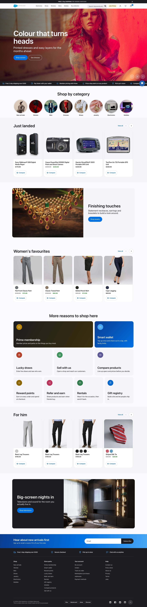
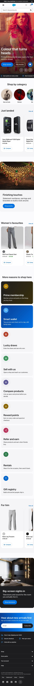
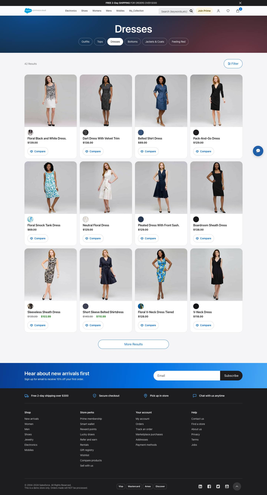
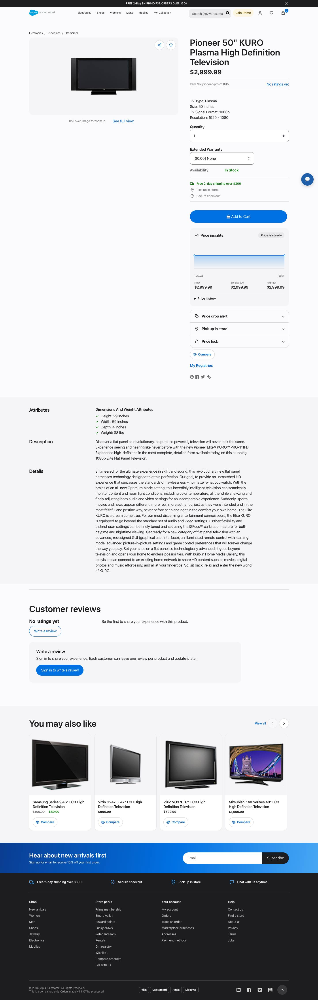
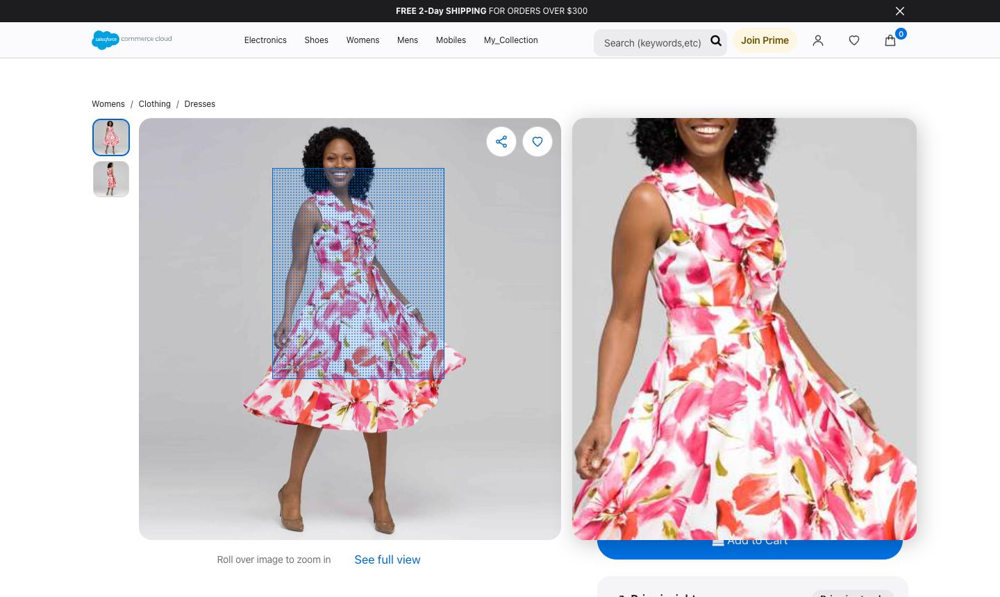
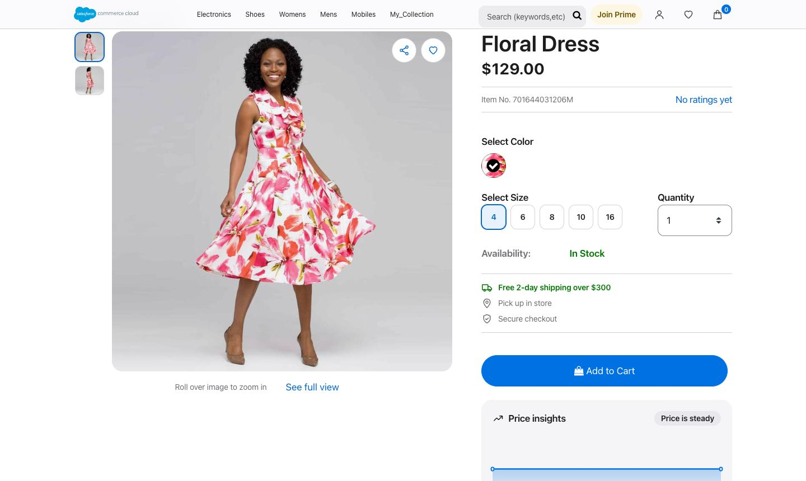
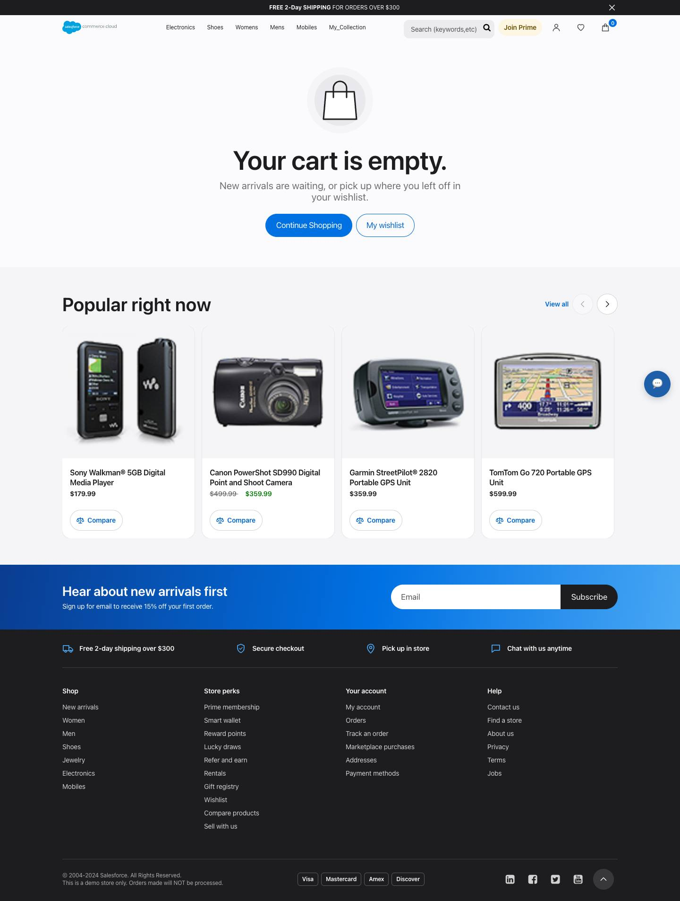
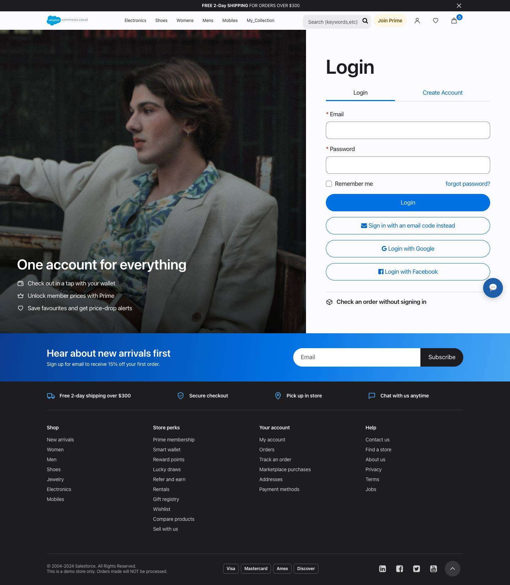

# Storefront redesign screenshots

Captured from the `RefArch_Practice` sandbox site as a guest. Install steps and implementation notes are in the [cartridge README](../../cartridges/app_custom_storefront/README.md).

## Home

## Home on a phone

## Category

## Product

## Product image zoom

Hovering the image shows a lens over it and a magnified view beside it. Thumbnails sit on the left, with share and wishlist on the image.

## Stock and delivery

Sizes are buttons. Stock status and the shipping offer are coloured so they stand out.

## Empty cart

## Login

