# plugin_analytics: Storefront Analytics

`plugin_analytics` adds native storefront analytics to an existing SFRA storefront and reports it in Business Manager. It uses no Google Tag Manager, Google Analytics or any other third-party service.

- **Product engagement:** product impressions (counted only once a tile is half visible), selections, product page views and searches are sent from the browser in small, validated batches.
- **Cart and checkout:** add to cart, checkout start, shipping and payment steps are recorded on the server, and only when the base SFRA route accepted the step.
- **Orders:** purchases, cancellations and refunds come only from the orders themselves, and each order counts exactly once.
- **Reports:** Business Manager pages for the overview, products, rankings, categories, the checkout funnel, orders, search terms, health, and CSV export.

Every site keeps its own data, the currency is USD, and the storefront never waits on analytics: if analytics fails, the shopper's request carries on unchanged.

It is unit-tested (84 tests) and ran end to end on sandbox `zyeu-002` on 2026-10-28; see the [sandbox checklist](analytics-deployment.md#sandbox-validation-checklist).

## Feature guide

Screenshots from sandbox `zyeu-002` (site `RefArch_Practice`), taken on 2026-10-28. The numbered red boxes mark the feature each section describes.

### What the storefront sends

Shoppers see nothing new. A 2.7 KB script, loaded through the `app.template.afterFooter` hook, watches product tiles (`.product[data-pid]`) and sends:

1. an **impression** when at least half of a tile becomes visible, once per list and position, so tiles loaded later by "More" count but a re-rendered tile does not count twice;
2. a **selection** when the shopper clicks a tile link. Quick view and a double click do not count again.

Product pages send one **product page view** per page load, and search results send the **search term** with the result count. Events go out in batches with `navigator.sendBeacon`, when the batch is full, after 10 seconds, or when the page is hidden.

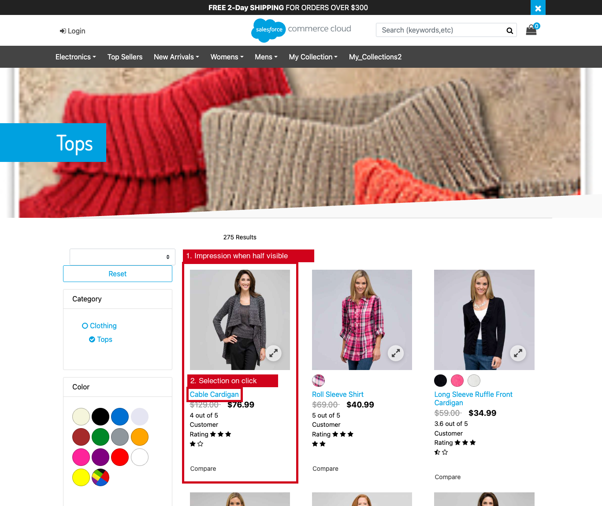

`Analytics-Collect` accepts only these four browser events, only from the same host, and only for sessions with tracking consent. It checks every field and rate-limits each session. A browser cannot send a purchase, a cart addition or revenue. See the [event contract](analytics-event-contract.md).

### Cart, checkout and orders

The plugin adds to the base routes with `server.append` and never replaces them:

| Route | Records | Only when |
|---|---|---|
| `Cart-AddProduct` | Add to cart: quantity and the basket's own unit price | The base route reported no error |
| `Checkout-Begin` | Checkout start, once per basket and session | The page was not redirected back to the cart |
| `CheckoutShippingServices-SubmitShipping` | Shipping step: method and country only | The base route accepted the step |
| `CheckoutServices-SubmitPayment` | Payment step: payment method ID only | The base route accepted the step |
| `CheckoutServices-PlaceOrder` | Links the order to its checkout attempt | The order was placed |

On the sandbox, a single session that opened the checkout page twice and placed an order counted as one checkout start, one shipping step, one payment step and one purchase.

Sales figures are read from the orders by the `Analytics-ReconcileOrders` job. Each order keeps what it last contributed (`Order.custom.analyticsSnapshot`), so when an order is paid later, cancelled or refunded, the reports change by exactly the difference. Re-running the job changes nothing.

### Overview

Pick a period: today, yesterday, last 7 or 30 days, current or previous month, or a custom range. Then compare it with the previous period of the same length.

1. The period filter, in days of the site time zone.
2. Engagement, cart, checkout and sales figures with their change, plus average order value, checkout completion, and cart and checkout abandonment.
3. The daily trend of product page views and net revenue.

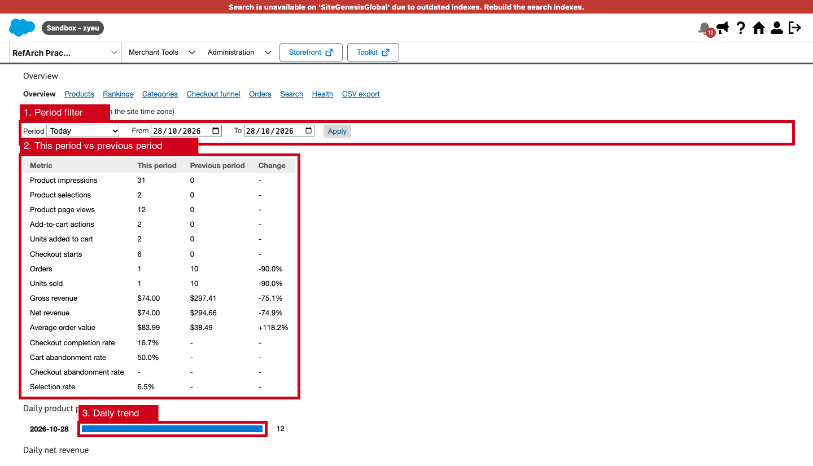

A notice appears whenever the data is sampled or events were dropped. Counts are never extrapolated.

### Products

1. Search by product ID, filter by category, and sort by any column or rate.
2. One row per master product: variants roll up to their master.

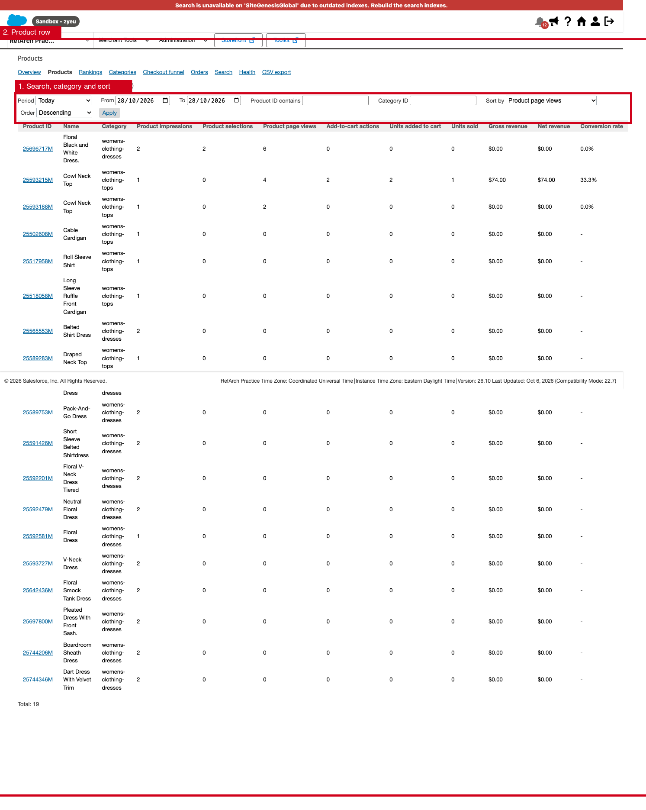

A product row opens the drill-down with totals, unique sessions, add-to-cart rate, conversion and daily figures.

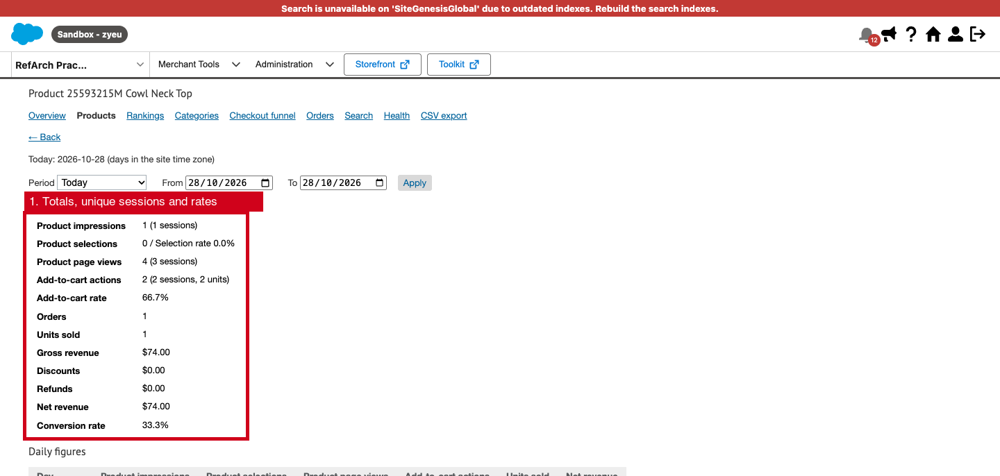

### Rankings

Top 10 lists: most viewed, most selected, most added to cart, best-selling, highest revenue, highest converting, and best cart-to-purchase conversion. Bottom 10 lists: lowest-selling, lowest revenue, least viewed, most viewed without sales, often added to cart but rarely bought, and impressions without selections.

1. For the standard periods, the rankings job stores the lists every day. Other periods are computed when the page opens.
2. Each list shows up to 10 products. Ties are broken by a second metric and then by product ID, so the lists are stable.
3. The bottom lists include online catalog products without any activity.

Conversion lists only include products with at least `analyticsMinRankingViews` sessions.

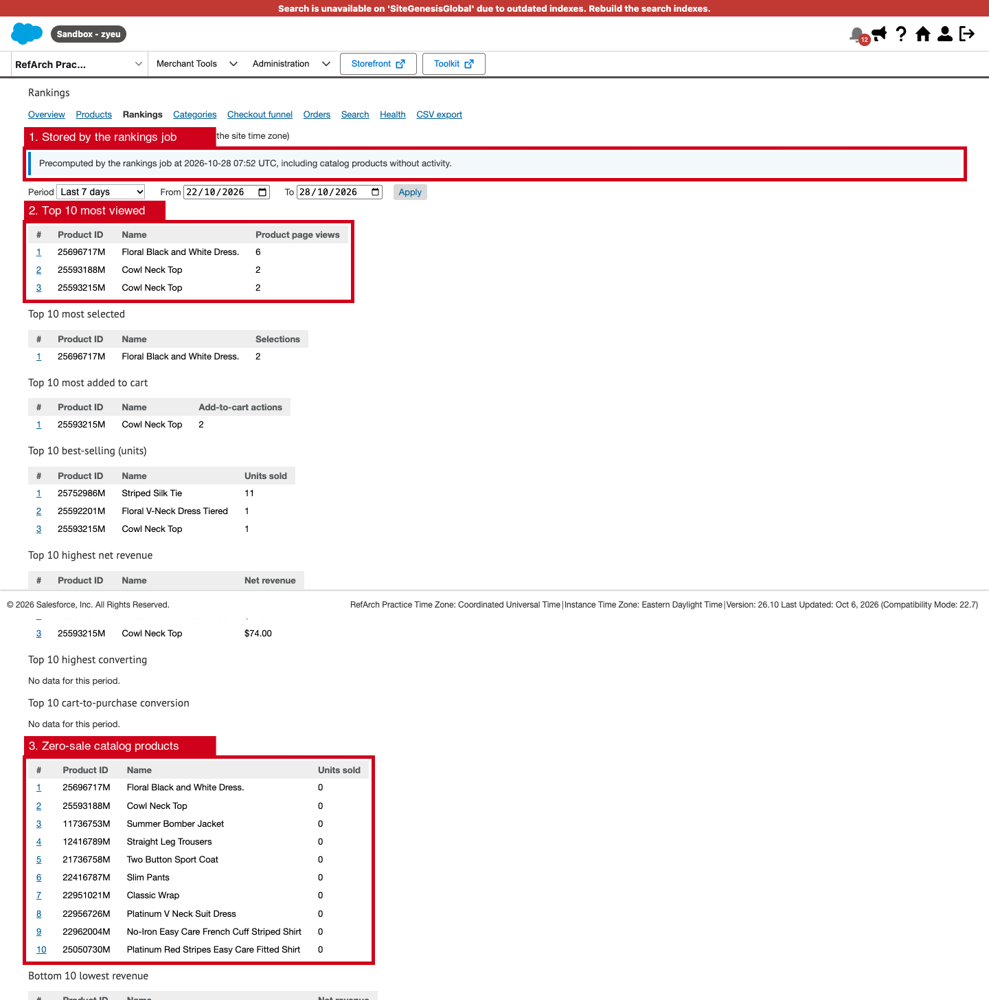

### Categories

1. Every product counts in one category only (its primary category), so the categories never add up to more than the site.
2. Each row shows its parent category, conversion and best product by net revenue.

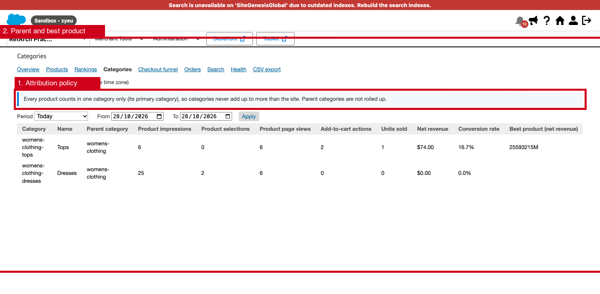

### Checkout funnel

1. Count sessions and checkout attempts, or raw events.
2. Each step shows its count, conversion from the previous step, drop-off and share of the first step.

The checkout steps are nested by checkout attempt. The discovery steps (impressions to product page views) are step ratios, not a strict cohort, and the page says so.

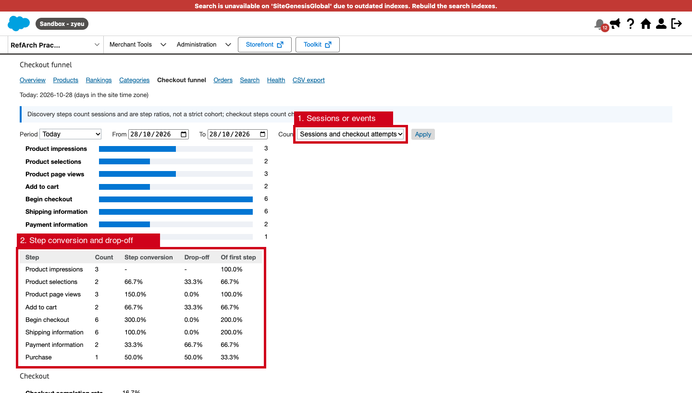

### Orders

1. Orders, units, gross revenue, discounts, refunds, net revenue, shipping, tax, order totals, average order value, cancelled orders and orders with refunds, per order day.

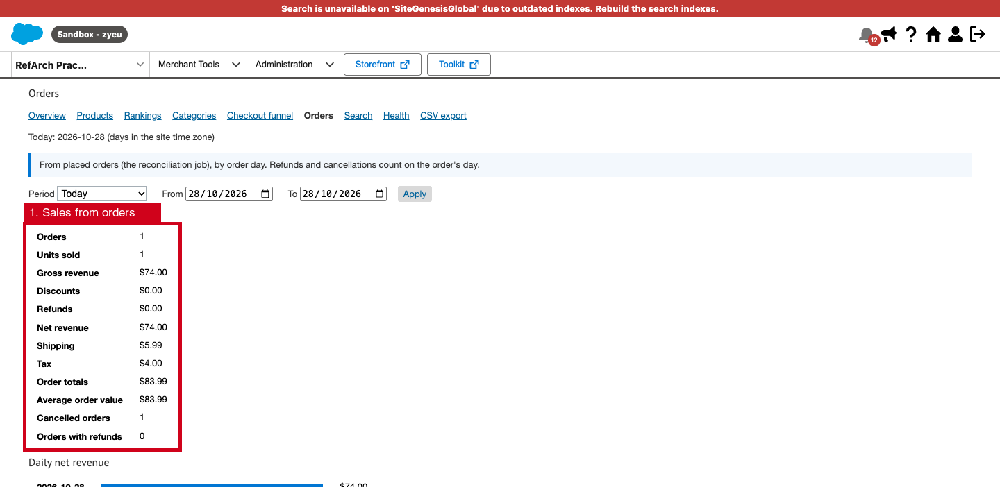

### Search

1. The top search terms with searches without results, products selected from search and the search-to-product rate.

Terms are stored lowercase, at most 50 characters long, and never when they look like an e-mail address or a long number. Search tracking is off until `analyticsSearchTrackingEnabled` is set.

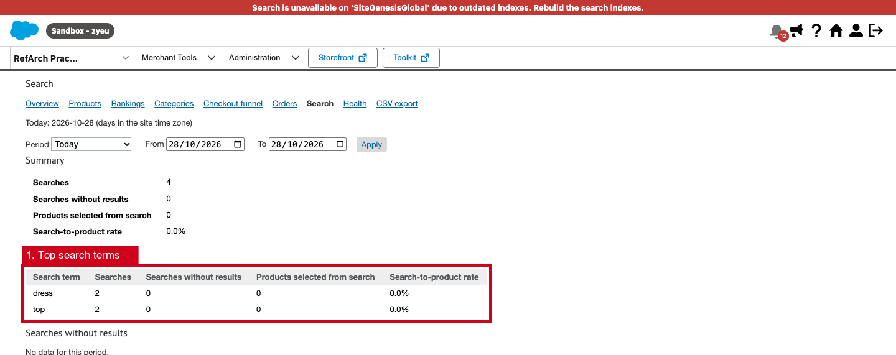

### Health

1. Collection: enabled state, currency, time zone, sample rate, backlog, paused collection, writer lock, and accepted, rejected and dropped events.
2. The last run, result and duration of each job, and the problems found by the last integrity check.

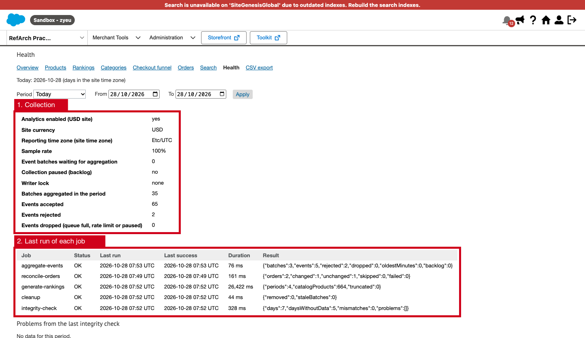

### CSV export

1. Daily site figures, products, categories and search terms for the selected period. Cells that a spreadsheet could read as a formula are prefixed with a quote.

CSV export is its own permission, separate from viewing the reports.

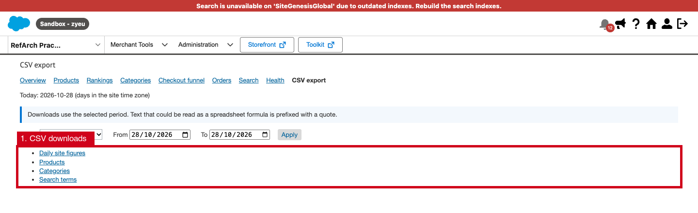

## Guides

| Guide | Contents |
|---|---|
| [Architecture](analytics-architecture.md) | Cartridges, data flow, design decisions, extension points |
| [Event contract](analytics-event-contract.md) | Beacon format, validation, stored events, deduplication |
| [Data model](analytics-data-model.md) | Custom objects, Order attributes, attribution policies |
| [Dashboard](analytics-bm-dashboard.md) | Pages, rankings, notices, permissions |
| [Jobs](analytics-jobs.md) | Job steps, schedules, statuses, recovery |
| [Configuration](analytics-configuration.md) | Site preferences |
| [Security](analytics-security.md) | Threats and controls, role setup |
| [Performance](analytics-performance.md) | Storefront cost, capacity, what happens under load |
| [Testing](analytics-testing.md) | Unit tests and sandbox results |
| [Deployment](analytics-deployment.md) | Install, configure, sandbox checklist, rollback |
| [Known limitations](analytics-known-limitations.md) | Accuracy limits and what is not built |
