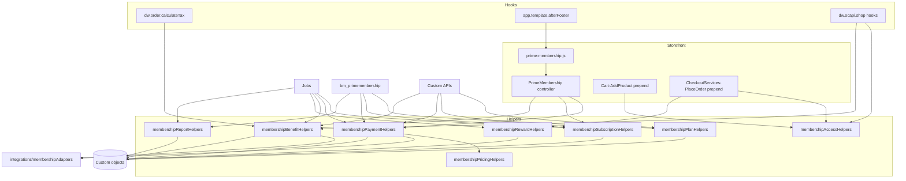
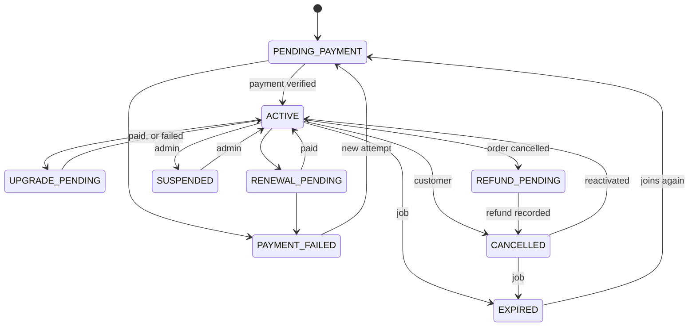

# Architecture and compatibility

## Repository audit

| Area | Finding | Consequence |
|---|---|---|
| SFRA | 8.0.0, base cartridge `app_storefront_base`; Bootstrap 5 in the repo, Bootstrap 4 CSS on the zyeu-002 sandbox | Templates use utilities that exist in both, e.g. `mr-2 me-2` |
| Basket calculation | `dw.order.calculate` in base runs promotions and shipping, then calls `dw.order.calculateTax` | Savings are applied on `calculateTax`, the same extension point `plugin_seller` uses |
| Order placement | `COHelpers.createOrder`, `handlePayments` and `placeOrder`, already wrapped by `plugin_loyalty` | Benefit reservation uses the same wrapper pattern |
| Payment | `basic_credit` is a stub: `Authorize` records a transaction ID and never sets `PAID` | Activation waits for `PAID`; see [payment flow](prime-membership-payment-flow.md) |
| Platform limits (measured on the sandbox) | 10 `createCustomObject` calls per storefront request across all cartridges; 4 custom attribute expressions per query | One usage row per order; e-mail through an outbox job; every query is within 4 expressions |
| Conventions | Helpers in `scripts/helpers/*Helpers.js`, forms in XML, `{error, errorCode, errorMessage, fields}` results, integer cents, separate `bm_*` cartridge, top-level `metadata/`, `docs/`, `test/` folders | Followed, so the folders differ from the tree in the original brief |

## Decisions

### The fee is a separate order from a temporary basket

`BasketMgr.createTemporaryBasket()` is documented for creating an order without disturbing the shopper's storefront basket. The fee is a non-catalog line.

| Option | Why it was or wasn't chosen |
|---|---|
| **Temporary basket, non-catalog line (chosen)** | The cart stays as it is. No catalog product, price book entry or inventory to manage. The fee can't appear in search. Other plugins' route appends on `CheckoutServices-PlaceOrder` don't run |
| Service product in the shopper's basket | Needs a catalog product and inventory, needs SFRA's shipping step for something that isn't shipped, and mixes fees with merchandise, so promotions and loyalty would see it |

What this means for each concern named in the brief:

| Concern | Behavior |
|---|---|
| Tax | Uses the normal tax hook with the billing address on the shipment. Tax class: `primeMembershipFeeTaxClass`, else the default |
| Shipping | The fee has none: the calculate hook sets the shipping line to 0 |
| Inventory | Non-catalog lines are left out of reservations (Script API documentation) |
| Fulfilment and export | `EXPORT_STATUS_NOTEXPORTED` unless `primeMembershipExportFeeOrders` is on |
| Discounts | The calculate hook strips every adjustment from a fee basket, and the place-order step compares the total with the quote |

Limit: a customer can have 4 open temporary baskets, each living 15 minutes. Quotes last at most 14 minutes. A fifth checkout in that window gets a "try again" message.

### Savings are custom price adjustments, not promotions

A native promotion can't enforce a per-customer annual cap, and it would need a customer group, which the brief says must not authorize paid benefits. So the plugin adds custom adjustments in the calculate hook, from the membership record, on every calculation.

**No customer groups are used.** They were optional in the brief, and without them there is nothing to get out of sync with the custom objects.

### No template overrides

`plugin_wallet` and others already override templates, and two overrides of one template can't coexist. The badge, labels and savings come from a script loaded by the `app.template.afterFooter` hook, which reads uncached JSON routes. This also keeps personalized data out of page-cached tiles.

## Structure

## Membership states

The full table is `TRANSITIONS` in `membershipSubscriptionHelpers.js`. Benefits apply in `ACTIVE`, `UPGRADE_PENDING`, `RENEWAL_PENDING`, `PAYMENT_FAILED` and `CANCELLED`, and only while the paid-through date is ahead.

## Compatibility with other cartridges

| Cartridge | Behavior | Change needed |
|---|---|---|
| `plugin_seller` | Seller offer lines get no member discount, because seller payouts come from the line price. `primeMembershipDiscountSellerOffers` turns it on once a funding policy is approved. Keep this cartridge to the right of `plugin_seller`, so offer prices are final when the discount is calculated | None |
| `plugin_wallet` | The wallet isn't offered for fees unless listed in `primeMembershipPaymentMethods`. The membership form only supports card-style processors today | None |
| `plugin_loyalty` | The fee earns no points, because the fee order skips the `COHelpers.placeOrder` wrapper. The multiplier pays out through the adapter after loyalty releases the order's points | None |
| `plugin_luckydraw` | Its job scans all paid orders and would have counted the fee | **One line in `luckyDrawEntryHelpers.js`:** non-catalog lines earn no entries |
| `plugin_analytics` | Its order job counts fee orders as purchases | **Open decision:** see below |
| Hook order | `app.template.afterFooter` and `dw.order.calculateTax` are shared, and all registered implementations run | None |
| Login | Uses `rurl` slot 10 | None |

### Open decision: `plugin_analytics`

Membership orders appear in analytics revenue today. The brief lists no rule for this, so nothing was changed. If fees should be left out, the same one-line check for non-catalog lines would do it in `analyticsAggregationHelpers.js`.

## Known limitations

- Some areas are still untested on a sandbox; see [testing](prime-membership-testing.md#sandbox-results).
- Page Designer components weren't built. Terms and FAQ are content assets; nothing else needed them.
- The membership checkout accepts card-style payment methods only, because its form is the base credit card form.
- E-mails are sent by a job, so they use the site's default locale, and arrive up to one job interval after the event.
- Two orders by one customer at the same moment can each pass a cap check, overrunning an annual cap by at most one order's cap. Custom objects have no row locks. See [security](prime-membership-security.md).
- Access rules are per product and not per category. A sale across a category needs the attribute on its products.
