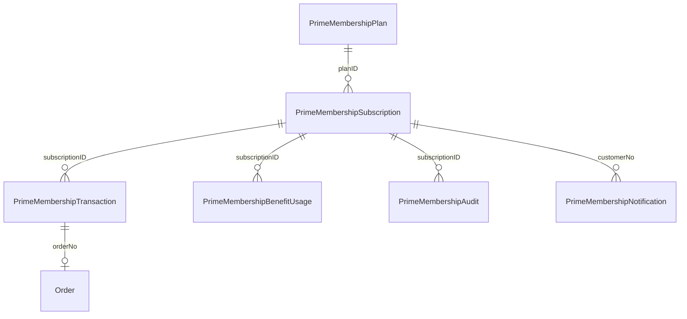

# Data model

All types are site-scoped custom objects without replication (`no-staging`), so each site has its own records. Money is stored as integer cents. Attribute definitions are in `metadata/plugin_primemenbership/meta/custom-objecttype-definitions.xml`.

The brief's names are kept, with two deliberate changes. Amounts end in `Cents` (`annualPriceCents`, `amountCents`, `discountCents`), and the types below add a few attributes the logic needs.

## Why the keys look like this

A custom object's primary key is the only uniqueness the platform enforces, so it carries the guarantees.

| Type | Key | What the key guarantees |
|---|---|---|
| `PrimeMembershipPlan` | `planID` | |
| `PrimeMembershipSubscription` | `subscriptionID` = customer number | One membership per customer per site |
| `PrimeMembershipTransaction` | `transactionID` = idempotency key: `TYPE:customerNo:nonce` | A repeated request can't create a second record |
| `PrimeMembershipBenefitUsage` | `subscription:benefit:orderNo` or `subscription:benefit:period` | One redemption per order, one reward per period |
| `PrimeMembershipAudit` | random | |
| `PrimeMembershipNotification` | `TYPE:dedupeKey` | One e-mail per event, also during retries |
| `PrimeMembershipJobState` | job name, `report-<day>` or `lock-<customerNo>` | One lock holder per customer |

## PrimeMembershipPlan

`planName`, `planRank`, `annualPriceCents`, `currency`, `validityMonths`, `enabled`, `benefits` (JSON; see [benefits](prime-membership-benefits.md)), `configurationVersion`, `createdAt`, `updatedAt`.

## PrimeMembershipSubscription

| Attribute | Meaning |
|---|---|
| `customerNo`, `siteID`, `planID`, `planVersion` | Who and what |
| `status`, `previousStatus`, `statusReason` | State machine |
| `startDate`, `expirationDate`, `paidThroughDate`, `renewalDate` | Term. Benefits stop at `paidThroughDate` |
| `autoRenewEnabled`, `autoRenewConsentAt` | Consent is recorded when the customer turns it on |
| `marketingEmailsEnabled` | Birthday and voucher e-mails |
| `sourceOrderNo` | Order of the last payment |
| `pendingTransactionID` | A payment in flight; blocks other money operations |
| `creditBaseCents`, `creditFromDate` | Paid value of the current segment, for proration |
| `benefitPeriodStart`, `benefitPeriodEnd`, `benefitCounters` | Running usage per benefit: JSON `{benefitID: {uses, cents}}` |

## PrimeMembershipTransaction

| Attribute | Meaning |
|---|---|
| `transactionType` | `PURCHASE`, `UPGRADE`, `RENEWAL`, `REFUND` |
| `status` | `QUOTED`, `PROCESSING`, `AWAITING_PAYMENT`, `COMPLETED`, `FAILED`, `EXPIRED`, `REVIEW`, `REFUNDED` |
| `sourcePlanID`, `targetPlanID`, `planVersion` | Plans, and the configuration the quote was made with |
| `amountCents`, `taxCents`, `totalCents`, `currency` | Fee, tax and what the customer pays |
| `quoteExpiresAt`, `quoteData`, `subscriptionStamp`, `basketUUID` | Quote, its proration figures, the membership state it was made for, and its basket |
| `orderNo`, `paymentReference`, `reviewReason`, `correlationID` | Links and diagnosis |

## PrimeMembershipBenefitUsage

`subscriptionID`, `customerNo`, `benefitID`, `usagePeriod`, `orderNo`, `discountCents`, `details` (JSON per benefit), `usageStatus` (`RESERVED`, `COMMITTED`, `RELEASED`, `REVERSED`, `ISSUED`), `rewardCode`, `loyaltyMultiplier`, `loyaltyStatus`, `createdAt`, `updatedAt`.

An order has one row with `benefitID` = `order-savings` and the split in `details`. The platform allows 10 custom object creations per request across all cartridges, and a wallet payment already makes 7.

## PrimeMembershipAudit

`actorReference` (`customer:…`, `admin:…`, `job:…`, `integration:…`), `action`, `subscriptionID`, `previousState`, `newState`, `correlationID`, `timestamp`.

## System object attributes

| Object | Attributes |
|---|---|
| `Basket`, `Order` | `primeMembershipTransactionID`, `primeMembershipSubscriptionID`, `primeMembershipSavingsCents`, `primeMembershipShippingSavingsCents`, `primeMembershipReturnDays`, `primeMembershipGiftWrap` |
| `Product` | `primeMembershipMinRank`, `primeMembershipPublicAt`, `primeMembershipLaunchAt` |
| `SitePreferences` | Group `PluginPrimeMembership`; see [Business Manager](prime-membership-business-manager.md) |

## Personal data

Membership records hold the customer number, no name, no e-mail address and no address. The e-mail address is read from the profile when mail is sent. Card data stays on the order's payment instrument, as in base SFRA. Reward codes are stored because the customer needs to see them.
