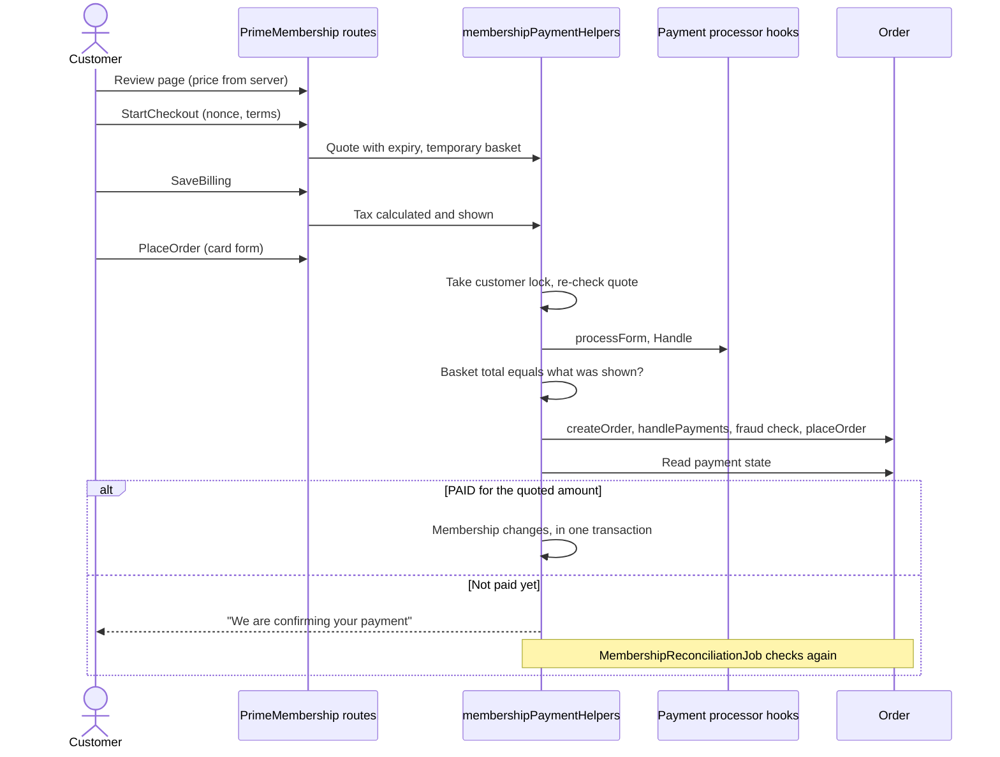

# Payment flow

## Purchase, upgrade and renewal



## What "verified" means

`activateFromOrder` is the only code path to entitlements from a storefront payment. It requires all of these:

1. The order belongs to this transaction and this customer.
2. Payment state is captured: `Order.paymentStatus` is `PAID`, or the payment adapter says `CAPTURED`.
3. The paid amount equals the quoted total, in the same currency.
4. The membership is still waiting for this transaction.

If 1, 3 or 4 fails, the transaction goes to `REVIEW` for a person. If the order failed or was cancelled, it goes to `FAILED`.

## The base card processor doesn't take money

`basic_credit` in `app_storefront_base` records a transaction ID and never sets `PAID`. With it, every card payment stays in `AWAITING_PAYMENT` until something sets the order to paid: a real gateway or an OMS. Business Manager's order screens show the payment status but can't change it.

To sell for real, connect a gateway that either sets `PAYMENT_STATUS_PAID` on the order, or implements `app.plugin.primemembership.payment`. A webhook isn't included because the repository has no gateway to receive one from. A gateway cartridge would verify its signature and update the order; the reconciliation job then activates the membership.

## Failure handling

| Case | Transaction | Membership | Customer |
|---|---|---|---|
| Invalid card | stays `QUOTED` | unchanged | Corrects it and retries |
| Declined | `FAILED` | First purchase `PAYMENT_FAILED`. Upgrade back to `ACTIVE`. Renewal `PAYMENT_FAILED`, benefits kept until paid-through | Told, not charged |
| Fraud check failed | `FAILED`, order failed | as above | Told |
| Order can't be placed | `FAILED`, order failed | as above | Asked to retry |
| Payment still pending | `AWAITING_PAYMENT` | Pending state, current benefits kept | Told it's being confirmed |
| Adapter unavailable | stays pending | unchanged | Job retries |
| Amount differs | `REVIEW` | Pending state, nothing granted | Told it's being checked |
| Tax changed since shown | stays `QUOTED` | unchanged | Reviews the amount again |
| Request crashed before an order | `FAILED` by the job after 30 minutes | restored | |

An order is failed only when payment was definitively refused. An unknown outcome never fails an order or refunds it, because money may have moved.

## Upgrade proration

```text
Remaining ratio    = remaining seconds / term seconds
Unused credit      = paid value of the segment x remaining / segment seconds
Target cost        = target annual price x remaining ratio
Charge             = target cost - unused credit
```

Example: Prime ($1,000) to Ultra Prime ($2,500) halfway through the term. Credit $500, target cost $1,250, charge **$750**.

| Rule | Behavior |
|---|---|
| Expiration date | Unchanged by an upgrade |
| Calendar | Real seconds, so leap years need no special case. Adding 12 months to Feb 29 gives Feb 28 |
| Earlier upgrades | The upgrade restarts the segment, with the target cost as its value |
| Refunds | Lower the value, so later credit is smaller |
| Tax | Calculated on the charge by the normal tax hook |
| Final hours | A charge under `primeMembershipMinUpgradeChargeCents` is refused, and the customer is asked to renew |
| Negative charge | Refused, and a person needs to look at it |
| Paid-in value | Proration uses the stored paid value, so a plan price change doesn't change what a member already paid for |

## Renewals

Manual renewal opens `primeMembershipRenewalWindowDays` before expiration and extends from the old expiration date, so paying early loses nothing.

Automatic renewal runs only when all of these hold:

- `primeMembershipAutoRenewEnabled` is on
- `app.plugin.primemembership.recurring` is registered (no implementation ships with this plugin)
- The customer turned it on, which records `autoRenewConsentAt`
- The membership is `ACTIVE`

Without the adapter, nothing is charged, whatever the flag says. The transaction key contains the term's expiration date, so a retried job can't charge twice for one term.

## Refunds

Money moves in the payment system. The desk or Admin API records it afterwards: the refund transaction lowers the credit value, and can end the membership. A cancelled order behind a completed payment is flagged by the job as `REFUND_PENDING`, which stops benefits until someone records the outcome. The job watches orders for 90 days after the payment.
