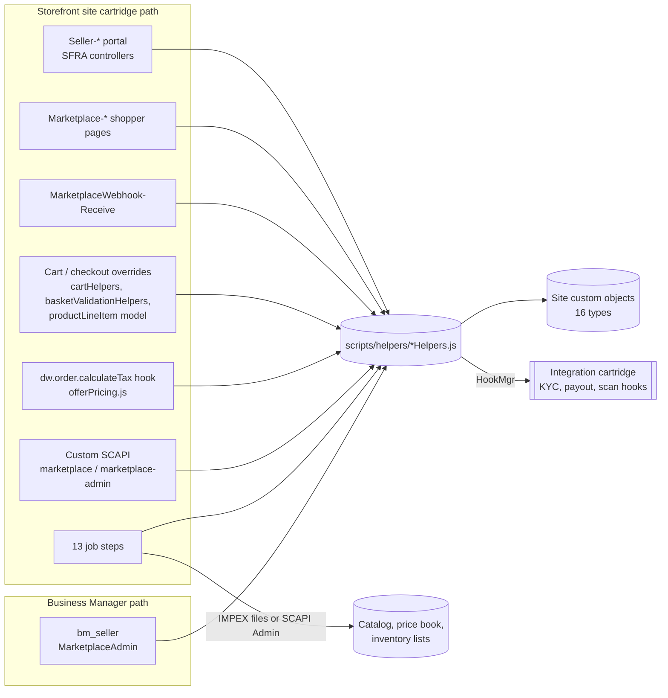
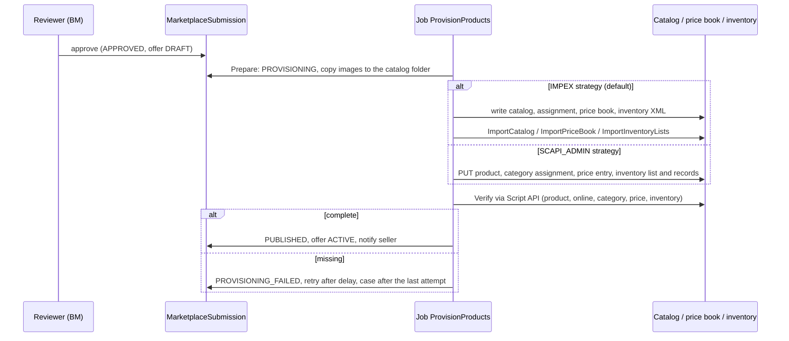
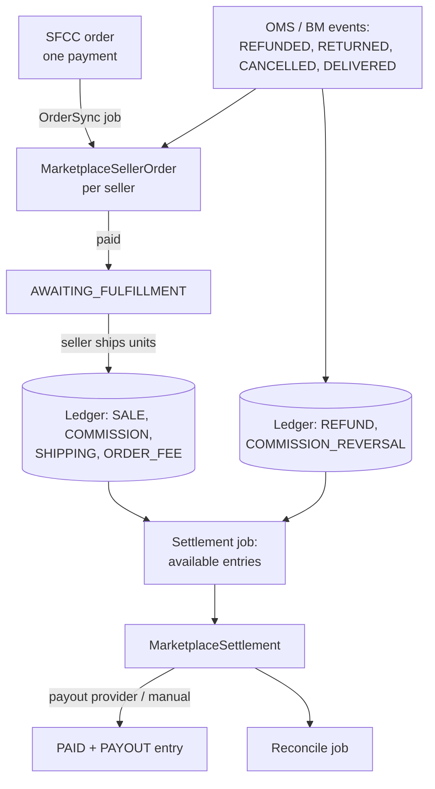

# Architecture

## Components

The cartridge follows the base SFRA layout. Business logic lives in `scripts/helpers/*Helpers.js`; controllers, Custom APIs, hooks and jobs call the same helpers, so a portal page and the matching API endpoint share validation and authorization. Helpers return base-style result objects: `{ error: false, ... }` on success, or `{ error: true, errorCode, errorMessage, fields }` on failure.

| Folder / file | Contents |
|---|---|
| `controllers/` | `Seller.js` (Seller Central), `Marketplace.js` (shopper pages), `MarketplaceWebhook.js` (provider results), `Cart.js` (prepend on `Cart-EditProductLineItem`) |
| `forms/default/` | `sellerApplication.xml`, `sellerSettings.xml`, `sellerOffer.xml`, `sellerProduct.xml`, used with `server.forms.getForm()` |
| `models/productLineItem/productLineItem.js` | `module.superModule` extension: offer price, seller availability, "Sold by" |
| `scripts/cart/cartHelpers.js`, `scripts/helpers/basketValidationHelpers.js` | `module.superModule` overrides for offer lines |
| `scripts/helpers/marketplaceHelpers.js` | Shared pieces: on/off check, bounded queries, IDs and HMAC, webhook signature, rate limits, status moves, audit, notifications, cents formatting, API responses, job state |
| `scripts/helpers/sellerHelpers.js` | Application, e-mail code, approval decisions, members and roles, `getSellerContext()`, settings, provider hooks |
| `scripts/helpers/sellerDocumentHelpers.js` | Private uploads with content sniffing, scan and review state, expiry, retention |
| `scripts/helpers/productSubmissionHelpers.js` | Product submissions and their review |
| `scripts/helpers/offerHelpers.js` | Offers, quality checks, availability, featured-offer ranking, basket lines |
| `scripts/helpers/catalogImportHelpers.js` | Import XML, publishing and offer sync |
| `scripts/helpers/sellerOrderHelpers.js` | Seller orders, commission rules, ledger, performance |
| `scripts/helpers/settlementHelpers.js` | Settlements, payouts, reconciliation |
| `scripts/helpers/caseHelpers.js` | Trust and safety cases |
| `scripts/services/scapiAdminService.js` | `LocalServiceRegistry` services for SCAPI Admin publishing |
| `scripts/hooks/offerPricing.js` | `dw.order.calculateTax` hook |
| `scripts/jobs/marketplace.js` | Job steps declared in `steptypes.json` |
| `rest-apis/marketplace`, `rest-apis/marketplace-admin` | Custom SCAPI endpoints |

Amounts are kept as integer cents in the records (no floating point in ledger sums) and shown with `StringUtils.formatMoney`. Status changes are checked against small status-flow tables in each helper (`canMove(flow, from, to)`).

## Identity and authorization

- A seller user is a registered storefront customer. `MarketplaceSellerMember` (key = customer number) links one customer to one seller with a role: OWNER, MANAGER, CATALOG, FULFILLMENT, FINANCE or VIEWER.
- `sellerHelpers.getSellerContext(customer, permission)` resolves the seller from the signed-in customer, then checks the role matrix and the account status (for example, a SUSPENDED seller can still ship and see earnings but cannot list). No request parameter selects the seller, so one seller cannot address another seller's records. Records of other sellers are reported as `not-found`.
- Business Manager access is controlled by six menu actions in `bm_extensions.xml`. Each controller node is registered under exactly one of them, so a role sees only the modules granted to it.

## Product and offer model

- **Offer** = `MarketplaceOffer`, key `<sellerId>:<productId>`. A product never gets duplicated for a second seller; the second seller adds an offer.
- **Seller-created products** come from approved `MarketplaceSubmission`s. Their product ID follows `sellerProductIdPattern` (default `{sellerId}-{sku}`). They are marked with `Product.mktOwnerSellerId`, and only their owner can submit changes.
- **First-party products** can also carry seller offers. Their price, stock and catalog attributes stay first-party. The plugin only adds offers.

### Pricing

Base `calculate.js` resets each line to its price-book price, then calls `dw.order.calculateTax`. Hooks for one extension point run in cartridge-path order (SFRA Hooks guide: "Hooks are executed in the order their cartridges appear on the path"). `plugin_seller` registers `dw.order.calculateTax`, so it runs after the reset and before the base tax implementation. There it:

1. Sets each offer line to the offer's price, read from the offer record.
2. Re-applies promotions and shipping when a price changed.
3. Adds seller shipping fees as product shipping line items (per item, waived above the seller's free-shipping amount).
4. Returns nothing, so the base tax hook still runs, including under SCAPI.

The featured offer's price is also written to the marketplace price book for seller-created products, so PLP/PDP prices and sorting match.

Checkout re-validates every offer line (`basketValidationHelpers.validateProducts`). It refuses a line when:

- the offer is no longer active,
- the seller is no longer approved,
- stock is insufficient,
- the inventory list does not match, or
- the price differs from the price applied at the last calculation.

### Inventory

- Every approved seller has an inventory list `sellerInventoryListPrefix + sellerId`. Offer lines are bound to it with `ProductLineItem.setProductInventoryListID`, the same mechanism the base cartridge uses for store pickup. The platform then reserves the seller's stock when the order is created.
- Storefront code cannot write inventory records. Stock changes are therefore flagged on the offer and written by the `SyncOffers` job.
- Each record carries an allocation timestamp equal to the time the seller entered the stock, so orders placed after that time are counted correctly.
- For seller-created products the site inventory list holds the sum of seller stock, so base availability messages, search refinements and the PDP add-to-cart button stay correct.
- A lower stock entered by the seller takes effect at once (minimum of declared stock and the list's ATS). A higher stock takes effect after the sync.

### Provisioning (approved submission to live product)

Both strategies are idempotent: import data is absolute, and SCAPI calls are PUTs. A submission stuck in PROVISIONING for over 2 hours is picked up again.

## Orders, earnings and settlement

- One SFCC order is never split into separately paid orders. The plugin tracks each seller's part and its fulfillment, and refunds and cancellations come in as events.
- Seller orders are created only by the job, from placed orders. Earnings are booked only after payment, as units ship.
- Ledger keys are deterministic: `<orderNo>:<seller>:<line>:SALE:<cumulative qty>`. Replays and concurrent runs therefore cannot double-book. An existing key with a different amount fails and is logged.
- Commission is resolved from the most specific rule, then frozen on the line. When no rule matches, nothing is booked and a COMMISSION_RULE_MISSING case is opened. A later run books it once a rule exists.
- Settlements include entries whose holding period has passed (`sellerSettlementHoldDays` after shipment). Balances below the minimum, or negative after refunds, carry over. Without a verified payout account a settlement is ON_HOLD.
- A PAYOUT ledger entry is booked only when the payout is confirmed. Reconciliation then checks that the settlement equals its entries and that the payout entry matches.

## Data volume and platform limits

- Custom objects are site-scoped and subject to the instance's custom object quota. The ledger, audit and notification types grow with order volume, so watch the quota warnings in Business Manager. Above roughly 10,000 orders a month, move the ledger and audit trail to an external store; `sellerOrderHelpers.postLedgerEntries` and `marketplaceHelpers.logAudit` are the only writers.
- JSON text attributes (seller order lines, case threads) are bounded in code: 100 lines per shipment, 200 remembered events, 50 messages per case. Text attribute size limits still apply to very large orders; this is spike S7.
- Queries use the bounded `marketplaceHelpers.queryPage`/`queryCount` and close their iterators. Jobs take `MaxItems` and resume from records or `MarketplaceJobState`.
- Custom Shopper API calls run with storefront quotas (10 s, 5 MiB). Uploads therefore go through the portal, not the API.
