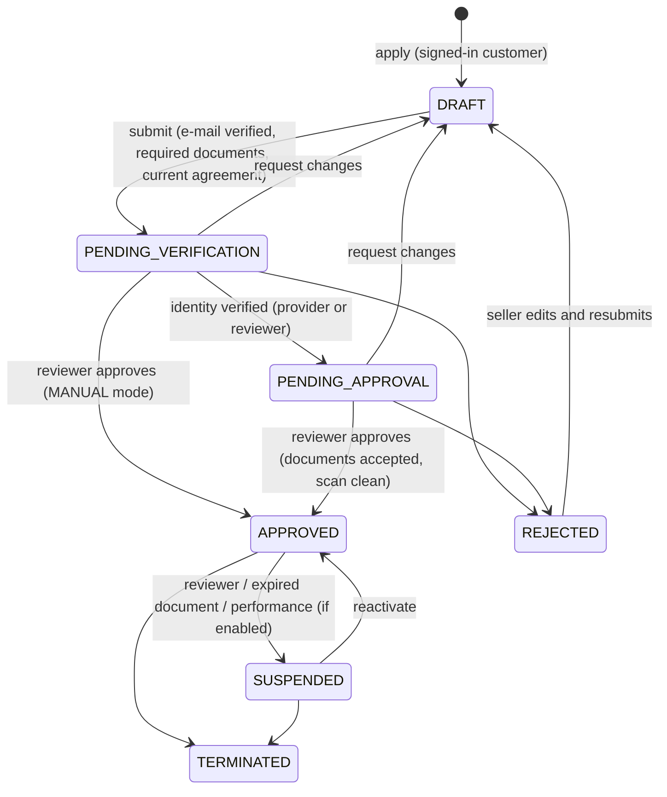
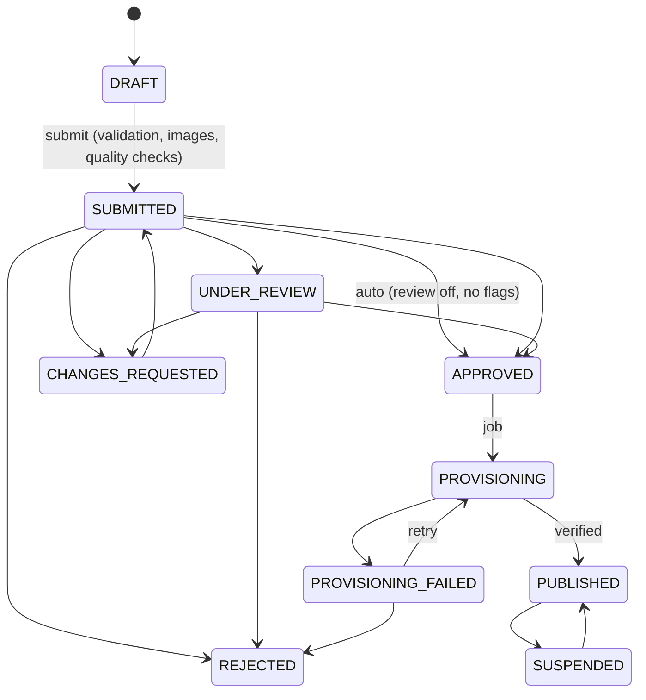
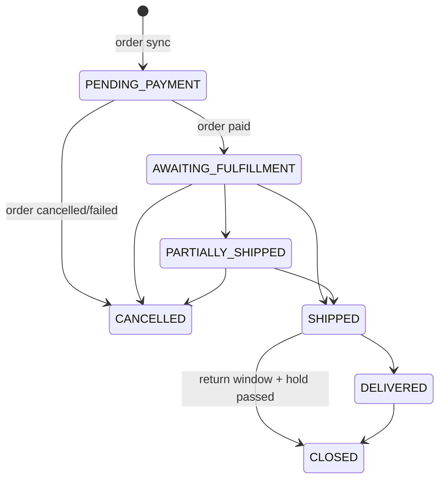

# Business flows

## 1. Seller onboarding

1. The shopper signs in and opens **Seller Central** (`Seller-Show`). They then start an application (`Seller-Apply`) with:
   - a seller code,
   - business, tax ID and address details,
   - contact details,
   - acceptance of the current agreement version (`sellerAgreementVersion`).
2. On the application page (`Seller-Application`) the seller:
   - requests a code (rate-limited, with a cooldown) and enters it to verify the contact e-mail,
   - uploads the documents listed in `sellerRequiredDocumentTypes`,
   - submits the application.
3. The identity provider runs (EXTERNAL), or the application waits for manual review (MANUAL). Admins are notified.
4. A reviewer opens Marketplace › Sellers, reviews each document (accept/reject), and approves. Approval requires:
   - every required document accepted and not expired,
   - clean scans when `sellerRequireCleanDocumentScan` is on,
   - a verified e-mail.
   On approval the seller gets an inventory list ID, and the catalog sync picks the seller up.
5. The payout account is connected from **Earnings**, through the provider's hosted page or by manual verification. Settlements stay ON_HOLD until it is verified.

Applications that share a tax ID with another live seller open a DUPLICATE_SELLER case. The applicant is not told.

## 2. Product submission

The seller clicks **Add product** and saves a draft. The draft holds:

- name and descriptions, brand, category and type (single product, or color/size variations),
- SKU, GTIN, specifications,
- price, stock, dimensions, returns, warranty, tax class,
- compliance documents for restricted categories.

The seller then uploads images and submits. Quality checks run on submit:

- duplicate SKU (blocks the submission),
- duplicate GTIN or title from another seller (flag),
- price outside the limits (blocks) or far from the reference price (flag),
- category not allowed (blocks); restricted category without a grant and compliance document (blocks), with a grant (flag).

Each flag opens a case and sends the submission to review. A reviewer compares changes with the live product (UPDATE mode), then approves, requests changes or rejects. The product is visible only after the provisioning job has created it and the verify step has confirmed product, category, price and stock.

## 3. Offers on existing products

- On **Offers**, the seller enters a product ID and chooses a price, stock, SKU, condition, handling time and returns.
- The product must be online, sellable (not a master, set or bundle) and in an allowed category.
- A new offer is ACTIVE immediately unless `sellerOfferApprovalRequired` is on or the price is suspicious; then it is PENDING_REVIEW.
- A later price change that needs review is kept as a proposal, and the live price stays until a reviewer accepts it.
- Stock is updated inline. A lower stock applies at once; a higher one after the next sync.

## 4. Shopper purchase

1. The PDP shows **Offers from sellers**, ranked:
   - `LOWEST_PRICE`: price, then rating, then handling time, then ID;
   - or `WEIGHTED`, using the configured weights.
   The featured offer is marked. For a master product, offers load once the shopper selects a variant.
2. **Add to cart** for an offer posts `mktOfferId` to the base `Cart-AddProduct`. The server checks:
   - the offer is active and the seller is approved,
   - the seller's stock covers the quantity, counting what is already in the basket,
   - the basket has no line of the same product from another seller.
   A seller-created product added through the normal button gets the featured offer.
3. The cart and checkout show "Sold by". Lines are priced from the offer, with the seller's shipping fee where configured.
4. At order placement the base checkout calls the overridden validation. The platform then reserves seller stock in the seller's inventory list.
5. Signed-in shoppers can see **Marketplace purchases** (`Marketplace-Purchases`), rate a seller once per shipped seller order, and report a listing (`Marketplace-Report`) as counterfeit or another issue.

## 5. Fulfillment, cancellations, returns and refunds

- The seller sees paid orders only, with the ship-to address while the order is open. They record shipments with carrier and tracking. Each shipment carries an idempotency key, so a double submit is applied once.
- The seller can request a cancellation, which opens a case. The marketplace (BM or OMS through `marketplace-admin`) confirms it with a CANCELLED event and refunds the shopper outside this plugin.
- Returns and refunds are recorded as events. A refund debits the seller and reverses the proportional commission (if the rule allows). It is capped at what was credited for the line.
- With `sellerUpdateOrderShippingStatus` on, the platform order is set to shipped when every seller part has shipped and the order has no first-party lines. This only works in job or API context.

## 6. Earnings and settlement

- Earnings are booked as units ship, and become available after `sellerSettlementHoldDays`.
- The **Settlements** job creates one open settlement per seller from available entries, when the net reaches `sellerSettlementMinimumCents`.
- **MANUAL payout:** finance pays the seller outside SFCC, then marks the settlement paid with the bank reference.
- **EXTERNAL payout:** the job (with `AutoRequestPayout`) or finance requests the payout. The provider confirms through the webhook.
- The **Reconcile** step checks every settlement against its ledger entries, and its PAYOUT entry once paid.

## 7. Trust and safety

Cases are opened automatically for:

- suspicious prices and duplicate listings,
- restricted categories,
- inventory mismatches,
- performance breaches,
- expired documents,
- integration failures, missing commission rules and reconciliation mismatches,
- shopper reports and seller cancellation requests.

Reviewers add notes, resolve or dismiss cases, and can enforce from the case:

- suspend the offer,
- suspend every offer of the product,
- suspend the seller.

Sellers see the cases about their own listings and orders, and can answer them.

Performance is evaluated daily over `sellerPerformanceWindowDays`:

- order defect rate (refunds, returns, complaints),
- late shipment rate,
- seller cancellation rate.

A breach of the limits (in basis points, once the seller has at least `sellerPerformanceMinOrders` orders) opens a case and warns the seller. It suspends the seller only when `sellerAutoSuspendOnBreach` is on.
