# plugin_seller: Seller Central marketplace

> **Status: sandbox and demo only.** It is unit-tested, and its main flows ran end to end on a sandbox on 2026-10-27 (see the [Feature guide](#feature-guide)). Payouts, identity verification and document scanning use manual review or hooks that you implement. Do not take live money or onboard real sellers until every item under [Production blockers](#production-blockers) is closed.

`plugin_seller` lets third-party sellers sell through an existing SFRA storefront in USD:

- Sellers register, verify their e-mail with a one-time code, upload verification documents and accept the seller agreement.
- They submit products for review and list offers on existing catalog products.
- They manage price and stock, ship their part of each order, and see their earnings and settlements.
- Marketplace staff review sellers, products, offers and cases in Business Manager. They also manage commission rules and settlements there.

One catalog product can carry offers from many sellers. Each offer has its own price, stock, handling time and return terms. One offer is featured (the "buy box"), and shoppers can still choose any other.

## Feature guide

Screenshots from sandbox `zyeu-002` (site `RefArch_Practice`), taken on 2026-10-27. The numbered red boxes mark the feature each section describes.

### Applying as a seller

A signed-in shopper opens `Seller-Apply` and fills in the business details and seller code, then accepts the seller agreement. If a check fails on the server, the error appears next to the field and everything the shopper typed is kept. Here the seller code `admin` is reserved.

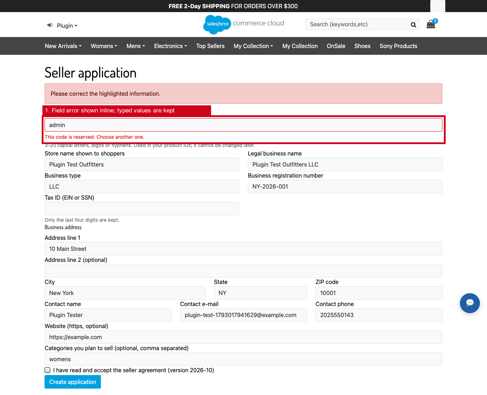

### Verifying the e-mail and uploading documents

The application page sends a one-time code to the contact e-mail. It also takes the documents the marketplace requires (Business registration and Identity document here). **Submit for review** stays disabled until both steps are done.

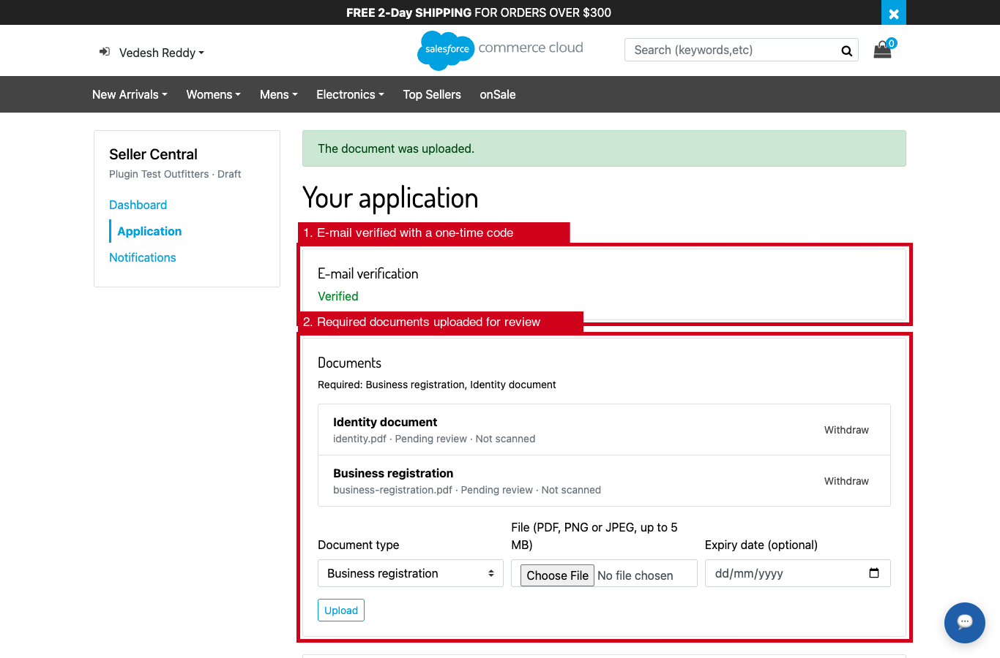

### Review and approval in Business Manager

Merchant Tools › Marketplace › Overview shows the work queues and checks the configuration.

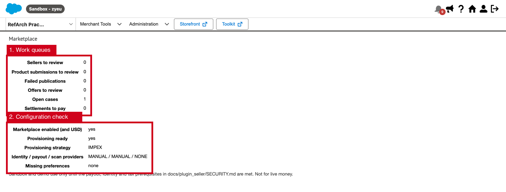

The seller page shows the status, the identity and payout checks, and the documents (each one opens in a viewer with its SHA-256). It also lists the **approval blockers**: approval is possible only when that list says "none". The tax ID is shown masked.

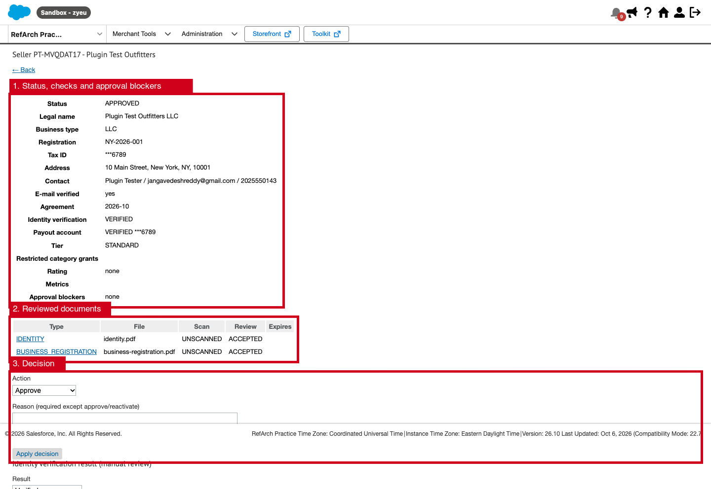

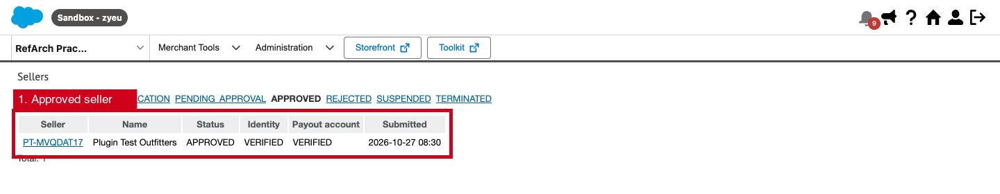

Every decision is written to the audit trail with the actor and the time.

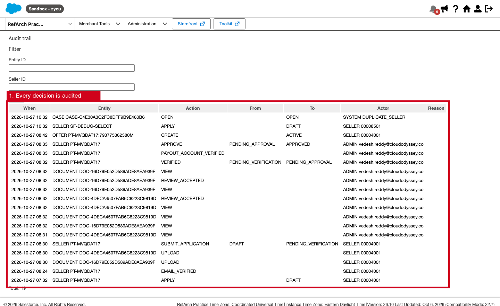

### Seller Central

Once approved, the seller works from Seller Central: orders to ship, late shipments, active offers, products in review, customer issues and earnings.

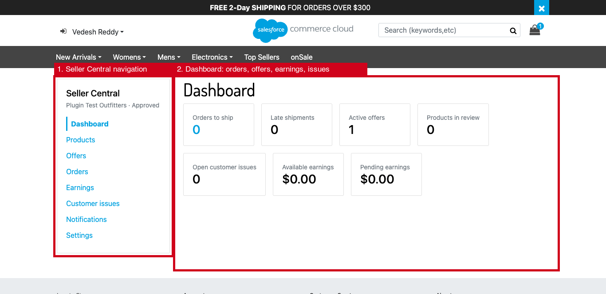

### Offers on catalog products

A seller can offer any catalog product with their own price, stock, SKU, condition, handling time and return window.

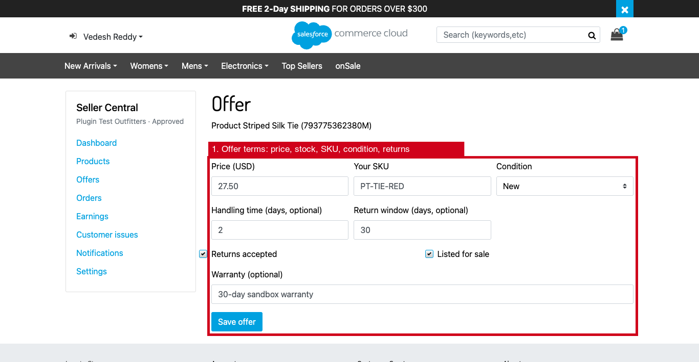

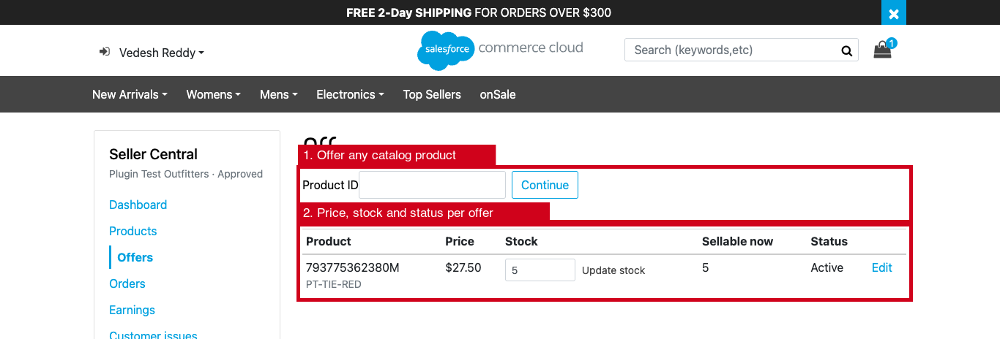

After the `MarketplaceSeller-SyncOffers` job, the offer appears on the product page under **Offers from sellers**, and shoppers can add it to the cart.

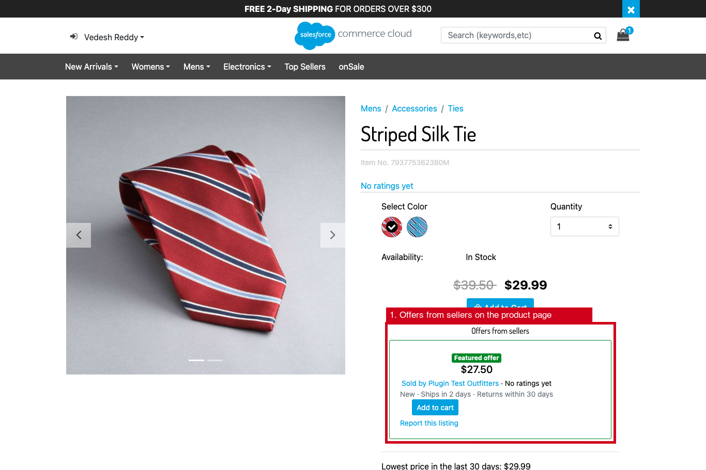

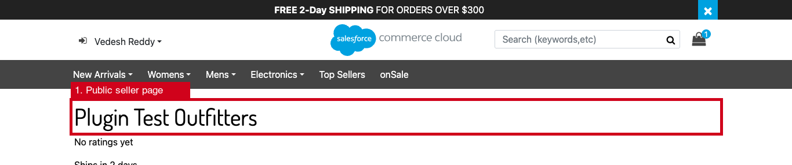

### Buying from a seller

The shopper adds the offer from the product page. The cart names the seller and charges the offer price ($27.50 here, while the catalog price is $29.99).

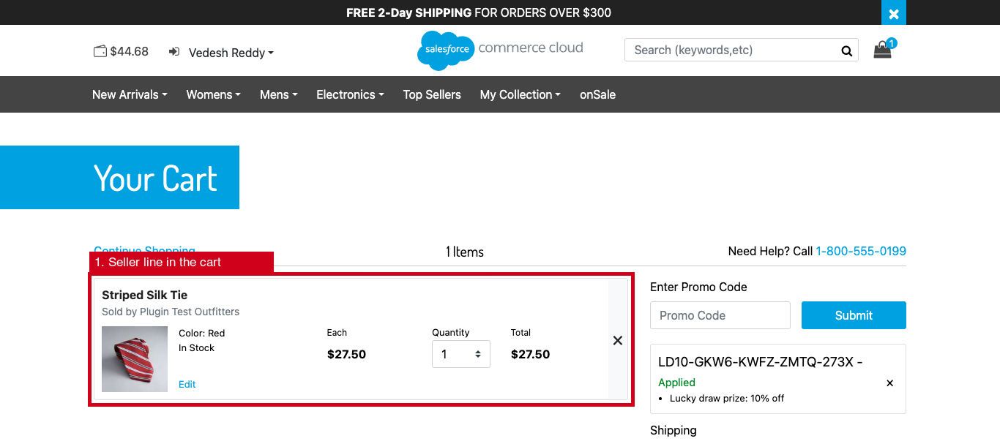

The order confirmation and order details also name the seller.

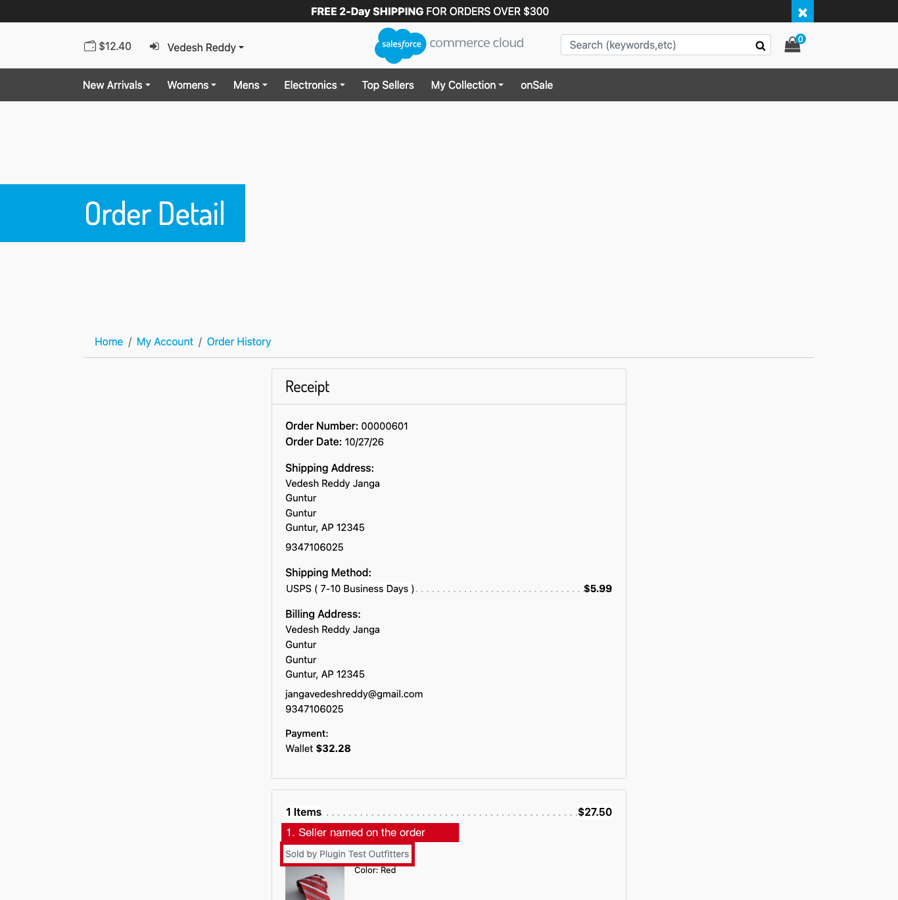

### Commission, seller orders and shipping

Marketplace › Finance holds the commission rules. Here a DEFAULT rule takes 10%.

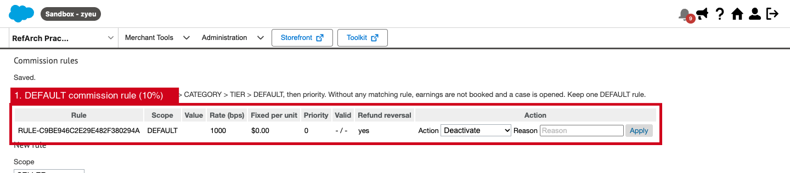

Once the order is paid, the `MarketplaceSeller-OrderSync` job creates the seller's own order, with the seller's lines and the commission already booked.

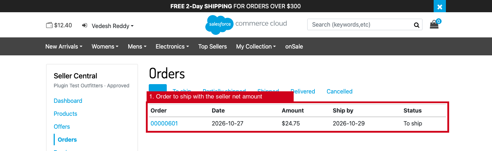

The seller ships from Seller Central with a carrier and tracking number. Earnings become available after the return window, and the `MarketplaceSeller-Settlements` job pays them out.

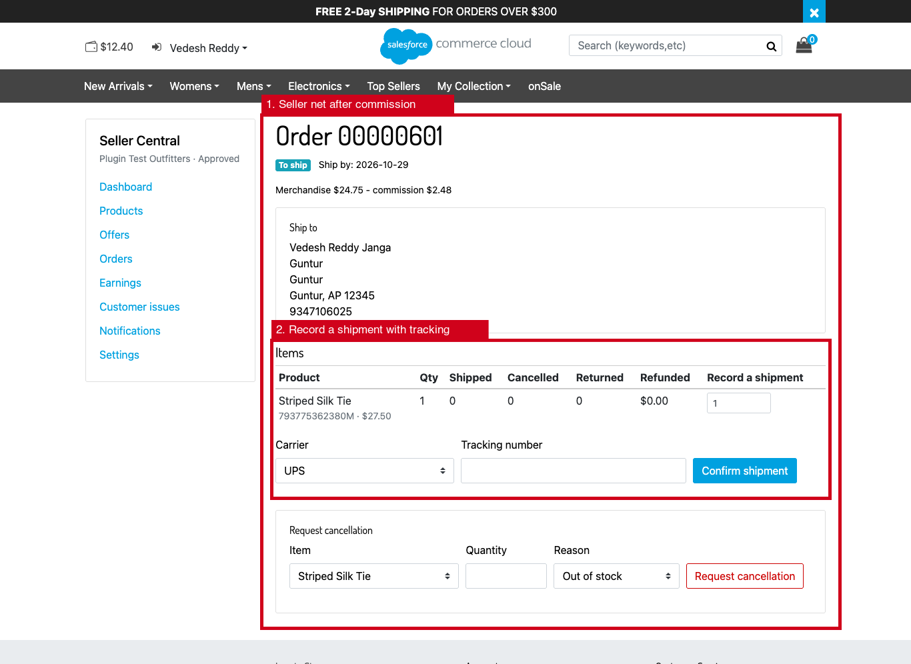

### Shipping and return settings

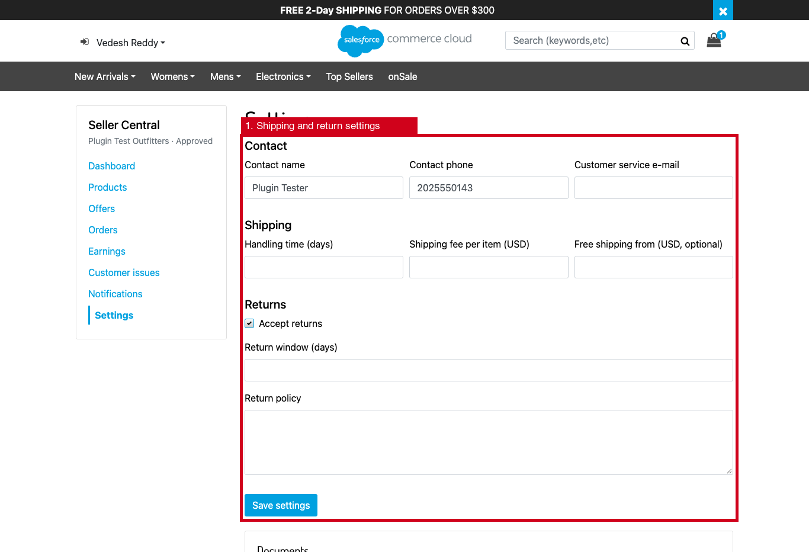

## Contents of the plugin

| Path | Contents |
|---|---|
| `cartridges/plugin_seller` | Storefront cartridge: the Seller Central portal (`Seller-*`), shopper pages (`Marketplace-*`), the provider webhook (`MarketplaceWebhook-Receive`), cart and checkout integration, offer pricing hook, Custom SCAPI APIs `marketplace` and `marketplace-admin`, and 13 job steps |
| `cartridges/bm_seller` | Business Manager cartridge: Merchant Tools › Marketplace (6 permission-scoped modules) |
| `metadata/plugin_seller` | Site import: 16 custom object types, 73 site preferences, product and line-item attributes, 10 jobs, 4 services, sandbox preference values |
| `test/plugin_seller` | 95 unit tests (Node + mocha with an in-memory Script API double) |
| `docs/plugin_seller` | This documentation |

## Documentation

| Document | Contents |
|---|---|
| [ARCHITECTURE.md](ARCHITECTURE.md) | Components, data model, pricing, inventory and order design |
| [BUSINESS_FLOWS.md](BUSINESS_FLOWS.md) | Seller, shopper and admin flows, with state machines |
| [CONFIGURATION.md](CONFIGURATION.md) | Every site preference, its default and its range |
| [METADATA.md](METADATA.md) | Custom objects, attributes, jobs and services |
| [API_REFERENCE.md](API_REFERENCE.md) | Controllers, Custom APIs, webhook and provider hooks |
| [SECURITY.md](SECURITY.md) | Security model, data handling and production blockers |
| [TESTING.md](TESTING.md) | What is tested, how to run the tests, and the sandbox test plan |
| [DEPLOYMENT.md](DEPLOYMENT.md) | Install, configure and enable the plugin |
| [ROLLBACK.md](ROLLBACK.md) | Disable or remove it safely |

## Quick start (sandbox)

1. Deploy `plugin_seller` and `bm_seller`, then add them to the cartridge paths: `plugin_seller:app_storefront_base` for the storefront, and `bm_seller:plugin_seller` for Business Manager.
2. Import `metadata/plugin_seller` as a site archive. Adjust `sites/RefArch_Practice` to your site ID first.
3. In Business Manager, enter the service secrets (`plugin-seller.hmac`, `plugin-seller.webhook`).
4. Create a DEFAULT commission rule (Marketplace › Finance).
5. Grant the Marketplace modules to the reviewer roles.
6. Open `Seller-Show` on the storefront.

The full procedure is in [DEPLOYMENT.md](DEPLOYMENT.md).

## Production blockers

These must be resolved and signed off before production use. They are explained in [SECURITY.md](SECURITY.md#production-blockers).

1. **Payouts**: an authorized payout provider (marketplace payments, KYC/KYB, 1099-K reporting) must be integrated through `app.plugin.seller.payout`. SFCC does not move money.
2. **Identity and payout-account verification**: integrate a verification provider, or keep manual review and get it approved by compliance.
3. **Malware scanning** of uploaded documents and images (`app.plugin.seller.scan`), or keep `sellerRequireCleanDocumentScan` on and scan out of band.
4. **Marketplace facilitator tax**: decide how sales tax is collected and remitted for third-party sales. The plugin uses the site's tax calculation unchanged.
5. **Sandbox verification**: S1 (install), S2 (buying an offer: offer price, "Sold by", seller order with commission, shipment) and S10 (all ten jobs ran OK) passed on `zyeu-002` on 2026-10-27, together with onboarding, review and approval. S3–S9 remain open; see [TESTING.md](TESTING.md#sandbox-verification-plan).
6. **Legal**: the seller agreement, privacy notice and document retention period need legal approval.
