# plugin_wallet: Smart Wallet

> **Status: sandbox and demo only. Not for Live Money.** It is unit-tested, and its main flows ran end to end on a sandbox on 2026-10-27 (see the [Feature guide](#feature-guide)). Top-ups go through a sandbox gateway that takes no real payment, and the balance has no cash value. Do not take real money until every item under [Production blockers](#production-blockers) is closed and signed off.

`plugin_wallet` adds a stored-value wallet in USD to an existing SFRA storefront:

- Registered shoppers add money to their wallet through a payment gateway (sandbox by default) and see their balance, activity and monthly summary in My Account.
- At checkout they pay with the wallet in full, or with the wallet and a card together.
- An owner can invite family members to pay from the owner's wallet within limits per order, per day and per month, optionally only for some categories and only with the owner's approval. Members never see the owner's balance.
- Payments need a one-time code above a configurable amount and from a new session. A shopper can lock the wallet at any time.
- Refunds can go back to the wallet. Chargebacks of top-ups are reversed.
- The cart shows how far the shopper is from free shipping, with items around that amount. A top-up never counts toward the threshold.
- Customer service works wallets, cases and the audit trail in Business Manager.

Every money movement is a balanced, idempotent double-entry journal. Balances can never be spent twice or become negative, even with concurrent checkouts.

## Feature guide

Screenshots from sandbox `zyeu-002` (site `RefArch_Practice`), taken on 2026-10-27. The numbered red boxes mark the feature each section describes.

### My wallet

The dashboard shows:
- the **Sandbox mode: Not for Live Money** notice
- the available and held balance
- the add-money form
- recent activity, with every hold, capture and top-up and its running balance

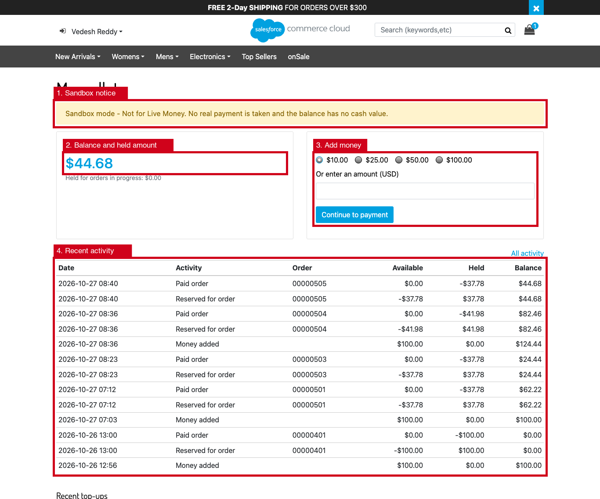

### Balance in the header

Signed-in shoppers see a wallet icon with their available balance in the header on every page. On phones it appears in the menu. It links to My wallet.

The balance comes from the `Account-Header` include, which SFRA renders uncached, so it is always current. A shopper who has not used the wallet yet sees $0.00, and signed-out visitors see nothing.

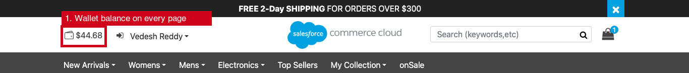

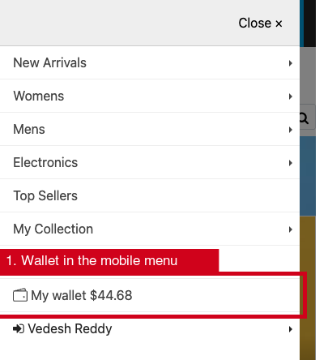

### Adding money (sandbox gateway)

**Continue to payment** creates a pending top-up and opens the sandbox payment page. It takes no real money. **Approve** credits the wallet exactly once, even if the approval is replayed. **Decline** marks the top-up as failed.

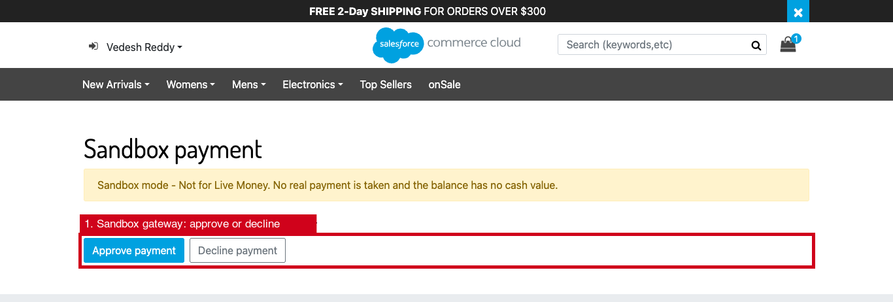

### Paying with the wallet in checkout

The payment step offers **Pay with wallet**.

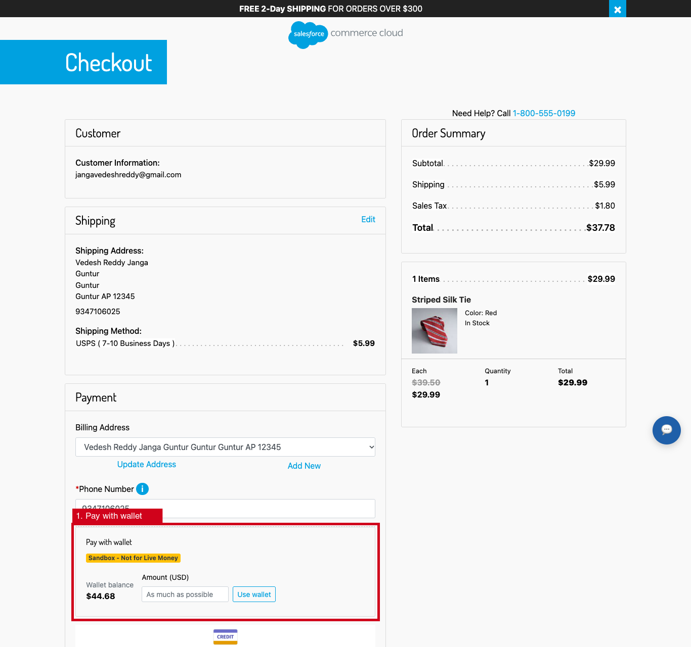

The wallet pays as much as it can, and any remainder goes to the card. The first wallet payment from a new session, or any payment above the step-up amount, needs a one-time code sent to the shopper's e-mail.

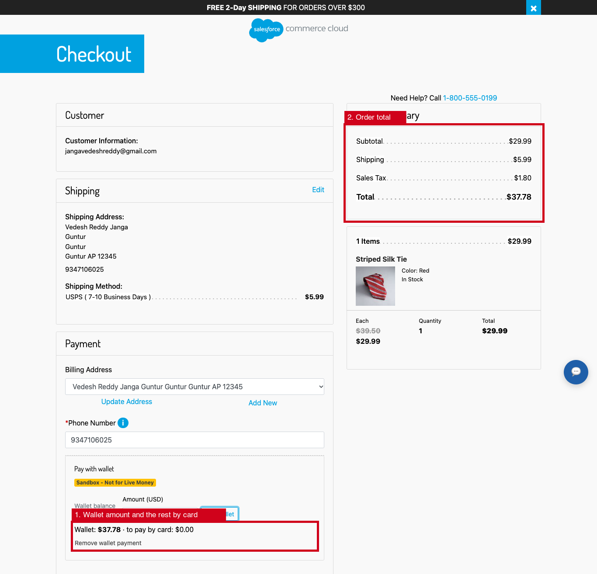

On the order, the payment shows as **Wallet**. At placement the amount is held, captured once the order is placed, and released if the order fails.

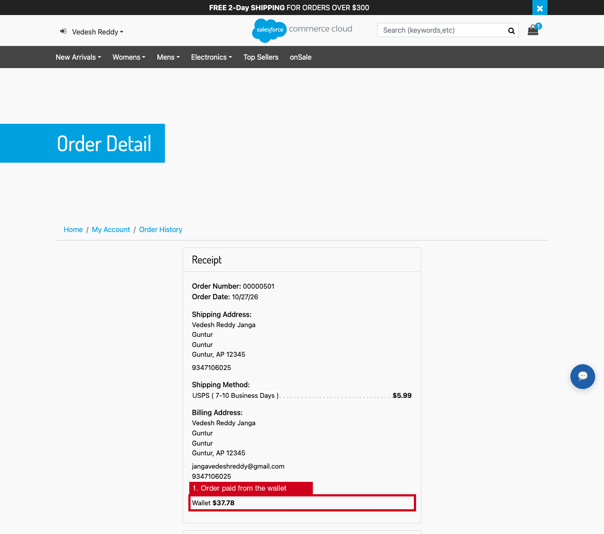

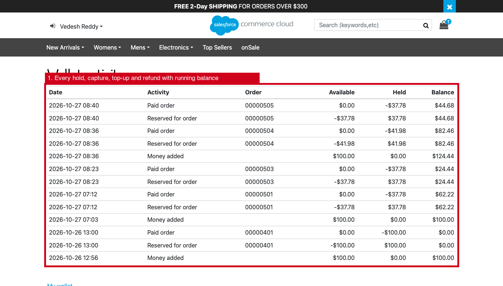

### Family members and lock

An owner can invite family members with a limit per order, and can lock the wallet at any time.

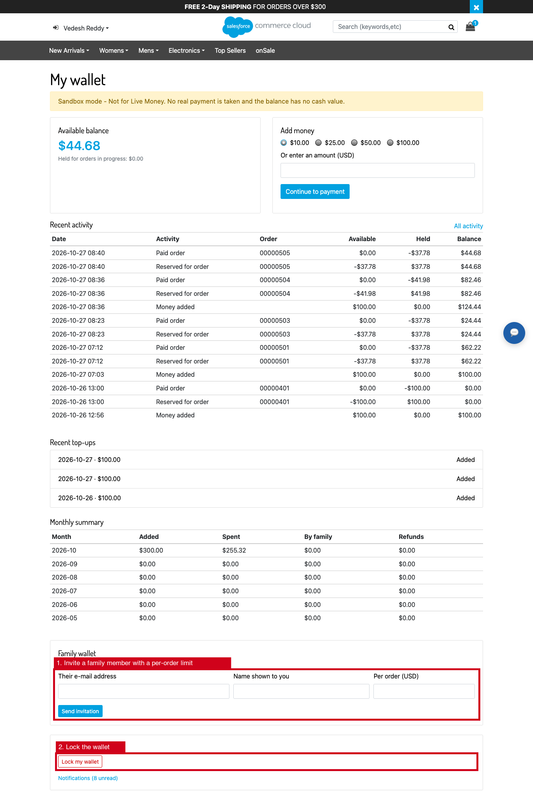

### Business Manager: Wallet

The Overview shows the total stored-value liability, the items that need attention, and configuration problems.

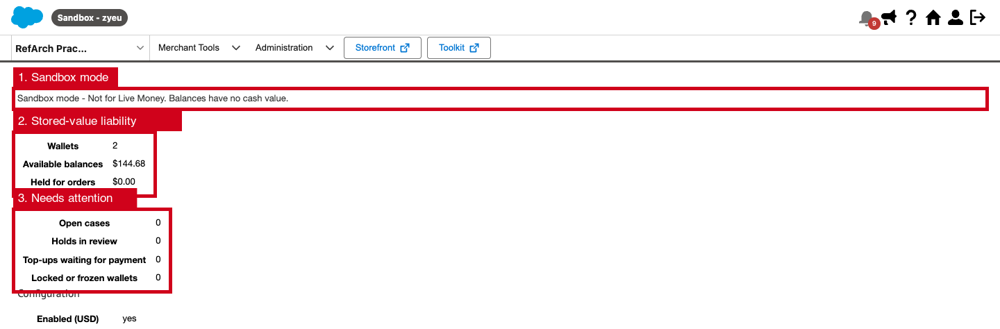

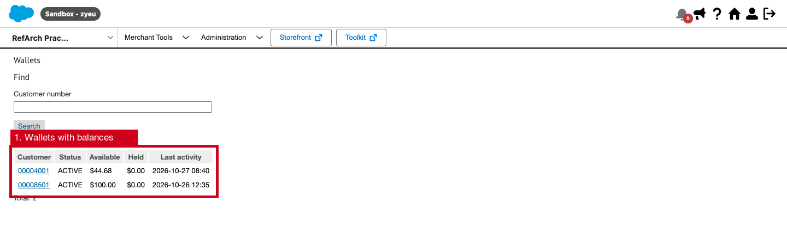

On a wallet's page, customer service can adjust the balance, refund, transfer or change the status. Each action needs a reason.

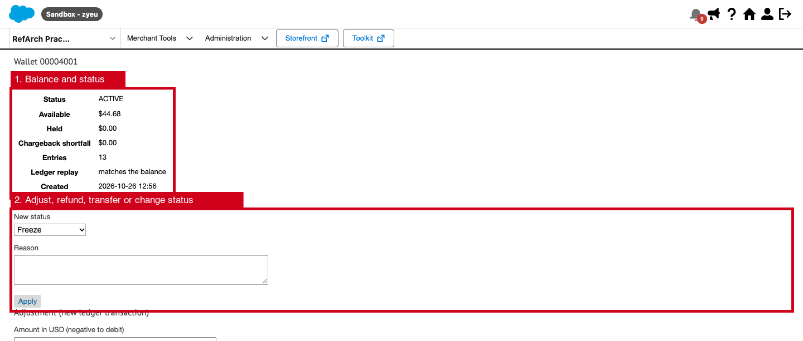

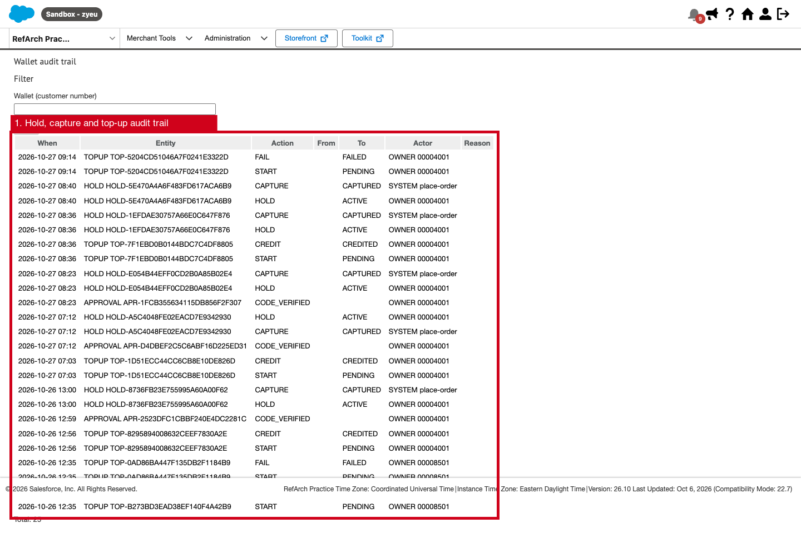

## Contents of the plugin

| Path | Contents |
|---|---|
| `cartridges/plugin_wallet` | Storefront cartridge: My Account wallet pages (`Wallet-*`), checkout integration (payment processor `WALLET`, PlaceOrder extension, split payment), the gateway webhook (`WalletWebhook-Receive`), the cart shipping advisor, Custom SCAPI APIs `wallet` and `wallet-admin`, and 7 job steps |
| `cartridges/bm_wallet` | Business Manager cartridge: Merchant Tools › Smart Wallet (4 permission-scoped modules) |
| `metadata/plugin_wallet` | Site import: 15 custom object types, 52 site preferences, 5 payment instrument attributes, the `WALLET` payment method and processor, 7 jobs, 2 services, sandbox preference values |
| `test/plugin_wallet` | 68 unit tests (Node + mocha with an in-memory Script API double) |
| `docs/plugin_wallet` | This documentation |

## Documentation

| Document | Contents |
|---|---|
| [ARCHITECTURE.md](ARCHITECTURE.md) | Components, ledger, payment lifecycle, concurrency design |
| [BUSINESS_FLOWS.md](BUSINESS_FLOWS.md) | Shopper, family, checkout, refund and admin flows, with state machines |
| [CONFIGURATION.md](CONFIGURATION.md) | Every site preference, its default and its range |
| [METADATA.md](METADATA.md) | Custom objects, attributes, payment method, jobs and services |
| [API_REFERENCE.md](API_REFERENCE.md) | Controllers, Custom APIs, webhook and gateway hook |
| [SECURITY.md](SECURITY.md) | Security model, data handling and production blockers |
| [TESTING.md](TESTING.md) | What is tested, how to run it, and the sandbox test plan |
| [DEPLOYMENT.md](DEPLOYMENT.md) | Install, configure and enable the plugin |
| [ROLLBACK.md](ROLLBACK.md) | Disable or remove it safely |

## Quick start (sandbox)

1. Deploy `plugin_wallet` and `bm_wallet`, then add them to the cartridge paths: `plugin_wallet:app_storefront_base` for the storefront, and `bm_wallet:plugin_wallet` for Business Manager.
2. Import `metadata/plugin_wallet` as a site archive. Rename `sites/RefArch_Practice` to your site ID first.
3. In Business Manager, enter the service secrets (`plugin-wallet.hmac`, `plugin-wallet.webhook`).
4. Grant the Smart Wallet modules to the customer service roles.
5. Sign in on the storefront and open `Wallet-Show`.

The full procedure is in [DEPLOYMENT.md](DEPLOYMENT.md).

## Production blockers

These must be resolved and signed off before real money is accepted. They are explained in [SECURITY.md](SECURITY.md#production-blockers). All of them are open.

1. **Regulatory classification**: a closed-loop stored-value program can fall under state money-transmitter, prepaid-access (FinCEN) and gift-card/escheatment rules. Legal must classify the program per state and approve the terms of use, before `walletLiveMoneyApproved` is set.
2. **Licensed payment gateway**: integrate a provider through the `app.plugin.wallet.gateway` hook (see [API_REFERENCE.md](API_REFERENCE.md#gateway-hook)). The sandbox gateway refuses to run on a production instance.
3. **Funds safeguarding and accounting**: finance must decide how customer balances are held (deferred revenue, segregated account) and reconcile the `Wallet-Reconcile` output with the provider and the general ledger.
4. **Refund and unclaimed-property policy**: cash-out on request, refunds of unused balances and escheatment of dormant balances must be defined. `walletFundsExpiryDays` stays 0 (no expiry) until then.
5. **Shipping benefit**: the "free shipping when the wallet pays" program is a merchant promotion. Its terms need approval, and the customer-group rule must be verified (spike W4).
6. **Sandbox verification**: W1, W2, W3 and W7 passed on `zyeu-002` on 2026-10-27. Run W4–W6 and W8–W10 in [TESTING.md](TESTING.md#sandbox-verification-plan).
7. **Headless checkout**: the wallet payment works in SFRA checkout only. A SCAPI/PWA checkout needs its own integration (see [ARCHITECTURE.md](ARCHITECTURE.md#limitations)).
